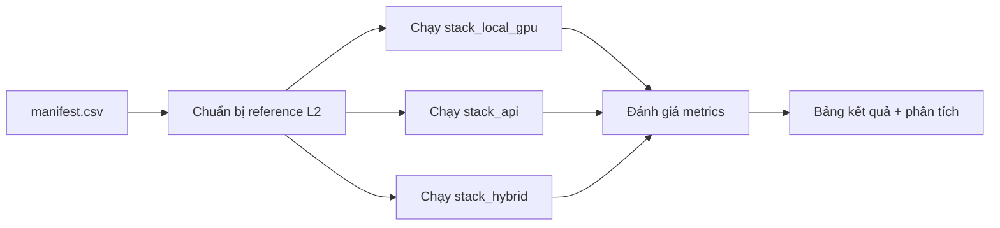

# Khung benchmark — Đánh giá trên video bài giảng thực tế

Hướng dẫn thiết lập, chạy và ghi nhận benchmark cho pipeline **multimodal-lecture-summarizer**.

Notebook chỉ được tạo khi có dataset, câu hỏi phân tích và phiên chạy cụ thể. Không tạo notebook khung hoặc notebook smoke. [Manifest](../experiments/notebooks/notebook_manifest.yaml) hiện ở chế độ `on_demand` với `notebooks: []`; hồ sơ chẩn đoán/EDA/đánh giá đã chạy nằm ngoài danh sách notebook hoạt động. Notebook `01a` và `01b` đã rời luồng hoạt động; archive giữ notebook đã chạy và receipt lịch sử, không giữ notebook smoke.

Các runner cũ trong `benchmarks/scripts/` cho RQ0A/RQ0V, RQ1–RQ4, EDA tổng quát, ablation ASR và error cascading tính bằng công thức đã được gỡ ngày 2026-10-07; `frozen_manifest_v1.json` và `provenance_template.json` cũng đã được gỡ. Những lệnh, bảng và manifest trong các mục lịch sử bên dưới mô tả thời điểm nghiên cứu trước, không còn là quy trình chạy hiện hành.

## Quy trình nghiên cứu hiện hành

1. **Chọn dữ liệu và ứng viên theo tác vụ:** chỉ chọn cohort video bài giảng hoặc bài thuyết trình học thuật có thể xác minh là cùng miền nghiên cứu, với nhãn có sẵn phù hợp đúng tác vụ. Ghi nguồn/phiên bản, quyền, modality, ground truth, đơn vị đánh giá, split/cohort và ít nhất hai họ mô hình hoặc thuật toán có ý nghĩa để so sánh. Không dùng video tổng quát làm benchmark phụ hoặc fallback. Chốt metric chính, normalizer, ngân sách đầu vào/đầu ra và tài nguyên chung trước khi xem điểm.
2. **EDA bằng notebook khi dữ liệu đã sẵn sàng:** chạy trên **toàn bộ cohort định dùng**, phân tích phân bố, chất lượng nhãn/media, thiếu dữ liệu, trùng/lệch split và nhóm khó. Ghi mẫu số, ngoại lệ và quyết định giữ, sửa có kiểm soát, giới hạn hoặc loại. Phân biệt kiểm kê metadata toàn corpus với kiểm tra media lấy mẫu. Nếu cohort thay đổi, cập nhật EDA và manifest trước khi đánh giá. Xem [điều kiện EDA](DATASET_EDA.md#quy-trình-eda-cho-cohort-mới).
3. **Đánh giá bằng notebook khi cohort và phép so sánh đã chốt:** chạy các họ ứng viên trên cùng đơn vị, GT, metric và profile tài nguyên của tác vụ; lưu dự đoán/lỗi từng đơn vị, receipt, bảng paired và giới hạn. Chỉ lựa chọn khi bằng chứng đủ; thiếu GT hoặc thiếu lượt chạy thì ghi `no_selection`/`not_eligible`.

| Tác vụ | Dataset dự kiến | Họ ứng viên để xét | Metric chính cùng thang đo |
|---|---|---|---|
| Scene/slide transition | [MLPDataset](https://github.com/mlpdataset/mlpdataset) có đoạn slide chuyển thủ công, **chỉ** phù hợp mục tiêu slide-transition; [MaViLS](https://github.com/andererka/MaViLS) có video–slide alignment, chưa phải scene GT. Scene chung vẫn `not_eligible` | `FixedGrid`, `ContentDetector`, `TransNetV2` đã khai báo; chỉ xét khi target khớp nhãn | One-to-one boundary F1 ở collar chốt cho đúng target |
| Board keyframe/visual evidence | [AccessMath](https://github.com/bhargavaurala/accessmath-icfhr2018) và [LectureMath](https://github.com/kdavila/lecturemath/blob/master/ACCESS2021_release/README.md) là ứng viên bài giảng bảng; nhãn keyframe, media, quyền và cohort chưa xác minh: `not_eligible` đến khi đạt | Midpoint; CLIP clustering/dedup; OCR-aware salience | Required-board-state/scene recall hoặc F1 cùng frame budget, chỉ khi GT phù hợp |
| OCR | [LectureVideoDB/IIIT-CVID](https://cvit.iiit.ac.in/research/projects/cvit-projects/lecturevideodb) công bố nhãn text detection và recognition trên frame bài giảng; chỉ dùng cho OCR, cần xác nhận quyền, media/GT cục bộ và xử lý lỗi nhãn/near-duplicate | Tesseract; EasyOCR; PaddleOCR, so recognition và spotting ở track riêng | CER cho recognition hoặc spotting Hmean cho end-to-end, không trộn track |
| Caption/VLM | Chưa xác minh được caption/evidence GT có sẵn trên video bài giảng: `not_eligible` | BLIP-class; Florence-class; VLM chỉ là ứng viên sau khi có GT | CIDEr nếu có multi-reference GT; grounded-support F1 nếu có evidence GT |
| Detection A — thành phần slide/bảng | [LVVO](https://arxiv.org/abs/2506.13657) có 1.000 frame bài giảng gán box thủ công cho table/chart/photo/illustration; [LectureVideoDB](https://cvit.iiit.ac.in/research/projects/cvit-projects/lecturevideodb) có text detection/recognition và được chấm ở track OCR riêng. Media, quyền và taxonomy LVVO cần xác minh: `not_eligible` đến khi đạt | `YOLOv11n`, `RT-DETR`, `Florence-2` chỉ so trên cùng 4 lớp LVVO đã chốt; text OCR so riêng | COCO mAP@[.50:.95] cho 4 lớp LVVO; OCR dùng metric riêng, không gộp điểm |
| Detection B — người/đồ vật/thiết bị tự nhiên | Chưa xác minh dataset video bài giảng có bbox và nhãn lớp tương ứng: `not_eligible` | `YOLOv11n`, `RT-DETR`, `Florence-2` chỉ là ứng viên khi cùng taxonomy và GT bài giảng | COCO mAP@[.50:.95] trong track B; không gộp mAP A/B |
| Multi-object tracking | Chưa xác minh GT bài giảng có persistent object ID qua frame: `not_eligible` | ByteTrack; BoT-SORT dưới cùng detector chỉ sau khi có GT | HOTA trên cùng video và detector cố định |
| Summarization (RQ2) | TIB: kiểm kê toàn bộ `train`, `valid`, `test` ở revision đã ghim, không lọc `genre`; báo riêng bản ghi thiếu đầu vào và chất lượng abstract. Vì đọc cả `test`, split đó không còn là holdout chưa xem. VISTA chỉ khi xác nhận quyền/media/GT cho cohort. Chưa chốt cohort chấm | `S1` fixed-chunk so với `S3` hierarchy dưới cùng LLM và token budget; các họ khác chỉ xét khi cùng điều kiện | ROUGE-Lsum chỉ khi reference phù hợp, kèm factual-support gate; keyshot F1 là track visual riêng |
| Retrieval/QA (RQ3) | EduVidQA; media visual tùy availability. EduViQA 20-video local snapshot **không phải** EduVidQA official | BM25; dense; hybrid/reranked, reader giữ cố định | Retrieval Recall@k; QA token F1 (EM là phụ) ở hai track riêng |
| System/efficiency (RQ4) | Cùng video bài giảng đủ GT có sẵn cho các stage đem so sánh; hiện `not_eligible` nếu chưa có | Các pipeline composition đã cố định | Quality gates và Pareto latency/VRAM/cost trên cùng profile |

Ma trận là **danh sách ứng viên cần xác minh**, chưa phải lựa chọn dataset hay kết quả benchmark. Các mô hình ghi trong [candidate registry](../experiments/registry/candidates.yaml) cũng chưa được tuyên bố đã chạy trên các dataset ứng viên này. Hai track detection có taxonomy khác nhau: chọn và so sánh ứng viên trên cùng nhãn trong từng track; không cộng hoặc xếp hạng chung mAP của A/B, cũng không gộp OCR Hmean với mAP. Dataset ngoài miền bài giảng không được thay thế khi một hàng chưa có GT. ASR `01c` và RQ1 là hồ sơ đã chạy ở mức diagnostic; người dùng hiện không dự định chạy lại các nhánh đó. Định nghĩa metric chi tiết nằm trong [metric registry](../experiments/registry/metric_registry.yaml) và [kế hoạch pipeline](../plans/260921-1943-scientific-benchmark-pipeline/plan.md#metric-registry-contract).

---

## 0. Evidence contracts hiện đã triển khai

Phần này lưu mô tả contract và hồ sơ repair **tại thời điểm chạy năm 2026**. Ngày 2026-10-07, mã generic D2 (`dataset_contracts.py`, `dataset_profile_schema.json`, `profile_dataset.py` và các driver freeze cũ) đã được gỡ khỏi luồng hiện hành. Các mô tả API, lệnh và test D2 ở mục 0.0–0.2 là bằng chứng lịch sử, không còn là hướng dẫn thực thi. Quy trình hiện hành nằm ở đầu tài liệu: mỗi notebook EDA/đánh giá phải ghi rõ nhãn, nguồn, split, leakage và receipt theo đúng tác vụ. Kết quả ASR `01c` đã thực thi nằm ở mục 0.2.2; không suy ra các điều kiện D2/full-DAG đã hoàn tất.

### 0.0 Hồ sơ reconciliation ngày 2026-09-26

Tại mốc 2026-09-26, Phase 1 đã sửa infrastructure nhưng chưa hoàn thành bằng chứng full-DAG/equivalence. Phase 2 chưa có D2 scientific eligibility mới: near-duplicate chưa chạy/adjudicate; cả 10 TED final-test unit cũ đã tham gia model/config selection. Historical ASR predictions/metrics của mốc này được giữ nguyên và chỉ dùng chẩn đoán; không gọi là clean holdout hay inference mới. Benchmark kiến trúc `01c` hoàn tất sau mốc này và được ghi riêng bên dưới.

Repair bổ sung hash từ nội dung code/config/dependency/upstream, disk reserve thực sau predicted peak, full media decode, thời gian/throughput đo thực, ASR selection chỉ trên validation, scorer English deterministic và figure enrichment đồng bộ receipt. Disk high-water chưa đo được ghi unavailable. SHA-256 chỉ chứng minh exact identity, không chứng minh absence of near-duplicates.

Mọi code run, subprocess output, exit code, test result và bảng/hình chẩn đoán của repair nằm trong notebook [phase12_evidence_repair.ipynb](../experiments/notebooks/diagnostics/phase12_evidence_repair.ipynb). Notebook này thuộc hồ sơ repair lịch sử, ngoài manifest `on_demand` hiện rỗng; lần repair trước có 22 node dự kiến. Output nằm trong notebook nguồn; bản chạy cũ và receipt được lưu trong `experiments/notebook_history_20260926.zip` với index SHA-256 tại `experiments/notebook_history_20260926.manifest.json`. Lần notebook đầu đã hoàn tất: 228 passed, 1 failed (offline-environment fixture; đã sửa). Final rerun đã hoàn tất: 233 passed trong 113.54 giây, 0 cell/infrastructure errors; supplemental shared-caller suite cũng pass 11 tests; tổng 244 = 233 + 11. Hai dataset driver trả 3 (pending), hai modality emitter trả 0, receipt validation không có lỗi và 151 file lịch sử không đổi.

Driver chỉ nhận artifact root mới/rỗng. Disk reserve fail trả 2 trước decode; near-duplicate pending ghi diagnostic bundle rồi trả 3. Diagnostic bundle giữ `unit_records` để xem, nhưng `unit_ids=[]`, `freeze_status=not_eligible`, `scientific_selection_eligible=false`; không được đưa vào official selection. Phases 3–7 và independent holdout/protocol vẫn pending.
Universal EDA vẫn là blocker: các SVG universal hiện là placeholder card, có `render_status=not_rendered` và pending reason. Notebook không trình bày card như measured plot; D2 validator từ chối eligible declaration khi universal figures chưa render. Chỉ **6 audio + 4 image modality figures** là plot thực. Số entry trong manifest không phải số plot đã hoàn thành.
### 0.1 Dataset freeze D2

API `validate_dataset_bundle()` trong `experiments/evaluation/dataset_contracts.py` fail closed khi một dataset được khai báo `eligible`. Một D2 freeze chỉ hợp lệ khi:

- dataset ID khớp giữa registry, profile, attrition, frozen manifest và endpoint matrix; số lượng profile/attrition/frozen unit nhất quán;
- registry và feasibility receipt đều là `D2`, source `available`, revision/rights rõ ràng;
- receipt đạt schema/checksum 100%, download tối thiểu 90%, decode tối thiểu 95%, predicted peak không quá 50 GiB và thời gian ước tính không quá 12 giờ;
- frozen unit ID khác rỗng, sorted, unique, resolve được; mỗi unit có bytes dương, SHA-256 hợp lệ, decode thành công và released ground truth kèm source, revision, annotation protocol;
- có cả split `validation` và `final_test`; không trùng unit ID, checksum, source, speaker hoặc talk giữa hai split. Registry phải ghi rõ `leakage_exception` nếu release không cung cấp speaker/talk identity;
- endpoint matrix cũng đánh dấu `scientific_selection_eligible: true`.

Dataset `not_eligible` vẫn được phép đi qua kiểm tra cấu trúc mà không giả lập D2: nó phải có `scientific_selection_eligible: false` và không có frozen unit ID. Artifact của profile smoke trước đây chỉ là chẩn đoán D0, không phải bằng chứng D2 hoặc benchmark chính thức; các thư mục output smoke cục bộ đã được xóa ngày 2026-10-07. Không tiếp tục dùng profile/luồng smoke cho notebook mới.

### 0.2 Characterization gate từng dùng cho notebook `00c` (lịch sử)

Runner `experiments.scripts.profile_dataset` gọi `validate_dataset_characterization_bundle()` trước khi ghi các artifact `00c`. Gate này kết hợp JSON Schema với kiểm tra ngữ nghĩa liên-artifact:

- đối chiếu dataset ID, revision, acquisition level, profile/scope, denominator, split count, attrition/quality exclusion, selected bytes và numeric summary với unit profile;
- ràng buộc `source_table_sha256` với payload nguồn đã canonicalize; figure phải dùng source artifact đã đăng ký, nằm trong artifact root, tồn tại trên đĩa và khớp SHA-256;
- tính lại exact cross-split overlap và duplicate checksum group từ unit profile, thay vì tin số đếm/findings do artifact tự khai báo; D2 còn yêu cầu near-duplicate đã adjudicate hoàn tất và không có exact overlap;
- với dataset D2, yêu cầu đủ tám figure ID phổ quát (`scale_bytes`, hai distribution, GT/missingness, attrition, split, source overlap, duplicate matrix) và kiểm tra semantic contract của từng figure: source artifact, unit, plot kind và measure. Nội dung của các universal figure không được trùng hash;
- kiểm tra cross-dataset comparison có metric definition tương thích, source hash/denominator đúng và `selected_bytes` khớp statistics.

Local inventory profiling và diagnostic D2-candidate characterization phải tách khỏi eligible scientific freeze. Các driver TED-LIUM/IIIT-CVID hiện giữ exact overlap checks nhưng không tự khai near-duplicate clearance; kết quả phải pending như mục 0.0. Root `experiments/outputs/phase2_tedlium_d2/official/full/` là historical output, không phải receipt mới sau repair. Test fixture pass chỉ chứng minh logic contract, không chứng minh dataset đã đạt mọi tiêu chí khoa học.

### 0.2.1 A0–A5 and preprocessing ablation — archived

The A0–A5 notebook (`01a`) and preprocessing-ablation task (`01b`) have been removed from the active notebook directory and execution manifest. Their executed notebooks, metrics, receipts, and run records remain in the historical outputs and notebook archive. These diagnostic runs included exposed native-test references, so retain their historical diagnostic classification. The A0–A5 Colab handoff and rerun instructions are retired. The architecture comparison `01c` below is also a retained historical result, outside the empty on-demand manifest.

### 0.2.2 Architecture-diverse ASR benchmark — completed 2026-10-05

Đây là notebook ASR đã dùng để so sánh họ kiến trúc, nay giữ làm hồ sơ kết quả. Sáu candidate độc lập được pin trong [`asr_architecture_candidates.yaml`](../experiments/registry/asr_architecture_candidates.yaml): Whisper/Faster-Whisper, Wav2Vec2-CTC, FastConformer-CTC, FastConformer-RNNT, Paraformer, Qwen3-ASR. Package pins và các Python environment riêng nằm trong [`asr_architecture_environment.lock.yaml`](../experiments/registry/asr_architecture_environment.lock.yaml). Model cards xác nhận FastConformer nhận mono 16 kHz và có các biến thể CTC/RNNT ([CTC](https://huggingface.co/nvidia/stt_en_fastconformer_ctc_large), [RNNT](https://huggingface.co/nvidia/stt_en_fastconformer_transducer_large)); Paraformer là ASR English non-autoregressive ([model card](https://huggingface.co/funasr/paraformer-en)); Qwen3-ASR 0.6B là mô hình multilingual hiện đại ([model card](https://huggingface.co/Qwen/Qwen3-ASR-0.6B)). Các điểm WER không cô lập riêng tác động của kiến trúc do training data, kích thước và toolchain khác nhau.

Notebook đã chạy cho tác vụ này là [`asr_architecture_colab_t4.ipynb`](../experiments/notebooks/asr_architecture_colab_t4.ipynb), ID lịch sử `01c_asr_architecture_benchmark`. Lệnh từng dùng để tạo bundle architecture riêng:

```powershell
python -m experiments.scripts.asr_colab_bundle --candidate-set architecture
```

Lệnh tạo `experiments/outputs/asr_architecture_colab_t4_inputs.zip` và `.zip.sha256`, chứa frozen inputs, mã nguồn, registry, lock và notebook. Notebook cài worker environments riêng, tải revisions đã pin, yêu cầu đúng Colab T4, exact package pins và `pip check`, rồi chạy một real inference cho mỗi lane. Chỉ khi đủ sáu probe pass mới chạy 6 × 507 validation attempts; 6 × 1.155 native-test attempts chỉ mở sau selection receipt complete và vẫn mang nhãn diagnostic do lịch sử test exposure. Bundle cũ có native test partial ở 6.929/6.930 cặp do một transcript rỗng; xem [ghi nhận sự cố](results/asr-architecture-empty-transcript-recovery-2026-10-05.md). Bundle đã sửa `asr_architecture_colab_t4_inputs_empty_transcript_261005_clean.zip` tạo run root mới `architecture_25ce9f1f300b`. Notebook đã lưu output và ZIP kết quả tải về xác nhận validation hoàn tất 3.042/3.042 cặp, native test hoàn tất 6.930/6.930 cặp, không còn failure. Qwen3-ASR 0.6B được chọn duy nhất trên validation với WER 3,91%; WER native test diagnostic là 3,53%. Xem [báo cáo đánh giá ASR](results/asr-architecture-evaluation-2026-10-05.md) để biết toàn bộ sáu kết quả, cách chấm và giới hạn.

### 0.3 Fail-closed ablation runner

CLI hiện có adapter cho `RQ0_OD` với hai toggle `conf_threshold` và `imgsz`:

```bash
python -m experiments.scripts.ablation_runner --task RQ0_OD --max-per-base 1 --seeds 42 --dry-run
```

`--dry-run` chỉ lập kế hoạch: mỗi row có `evidence_status=not_run`, `success=false` và metrics rỗng. Exit code 0 ở chế độ này chỉ xác nhận toàn bộ combo đã được lập kế hoạch, không xác nhận model đã chạy hay metric đã được đo.

Real result chỉ được chấp nhận khi subprocess tạo output mới khớp chính xác task/candidate/toggles/seed và config hash, có `evidence_status=real`, metrics hữu hạn gồm `map50`, `precision`, `recall`, cùng provenance đầy đủ về dataset/revision/checksum, ground-truth revision, model revision, runner version, prediction count và frame count. Runner object-detection hiện phát output `diagnostic` vì chưa nối released box/class ground truth; do đó chưa thể cung cấp real ablation evidence.

Các task ngoài `RQ0_OD` bị từ chối vì chưa có adapter. Real `RQ0_OD` chỉ nhận một seed vì pipeline hiện được xem là deterministic. `--parallel` trong real mode cũng fail closed cho đến khi frame input bất biến; parallel dry-run chỉ lập kế hoạch.

Audit mặc định được append vào `experiments/scratch/ablation_audit.csv`; output theo combo nằm dưới `experiments/outputs/ablations/`. Chỉ các run mà mọi combo có trạng thái `real` mới trả exit code 0 trong real mode.

### 0.4 Per-node DAG reconciliation & evidence ledger lịch sử (Plan 260926-0849)

Ledger dưới đây ghi trạng thái 21 node tại lần reconciliation trước, **không** phải danh sách notebook hiện có hoặc queue thực thi hiện hành. Các contract fail-closed được mô tả tại thời điểm đó:
1. **Endpoint matrix gating bắt buộc**: Mọi runner gọi `load_eligible_units` trong namespace `official` hoặc profile `full` bắt buộc phải có `dataset.endpoint_matrix` artifact và receipt hợp lệ. Payload phải có `schema_version: 1`; record phải có `dataset_id`/`endpoint` dạng chuỗi không rỗng và `scientific_selection_eligible` dạng boolean. Lỗi đọc, sai checksum, sai schema hoặc thiếu eligibility làm runner dừng (`RuntimeError`) trước khi nạp model hay tính metric.
2. **Cách ly dữ liệu audio-only khỏi visual/composite**: TED-LIUM chỉ có modality/GT phù hợp ASR; scientific eligibility hiện pending theo mục 0.0. Các runner nhóm visual (`02a`-`02d`) và composite (`07b`: ASR + scene + OCR + detection + tracking; `08a`: toàn bộ endpoint stage đem so sánh; `08b`: ASR + scene + summary + QA) từ chối tập dữ liệu này và fail closed.
3. **Phân định rõ ràng giữa dry-plan và kết quả khoa học**: Dry-plan đủ 21 node chỉ chứng minh tính toàn vẹn topological và sự tồn tại của runner source, không phải là bằng chứng hoàn thành DAG chính thức. Full DAG khoa học duy trì trạng thái `BLOCKED` cho đến khi toàn bộ endpoint tương ứng có dataset đủ điều kiện và released ground truth.

#### Bảng ledger trạng thái 21 node tại lần reconciliation

| ID | Nhóm | Trạng thái | Endpoint Gate / Yêu cầu dữ liệu | Bằng chứng thực tế / Lý do Blocked |
|---|---|---|---|---|
| `00a_environment_preflight` | 00 | **INITIAL DIAGNOSTIC VERIFIED** | Live reserve after predicted peak | Initial run receipts validated; 233-test final rerun passed |
| `00b_dataset_feasibility` | 00 | **INITIAL DIAGNOSTIC VERIFIED** | Full decode and measured provenance | Initial run receipts validated; no scientific D2 eligibility |
| `00c_dataset_eda_and_freeze` | 00 | **NOT ELIGIBLE** | Universal plots, near-duplicate adjudication and independent holdout | Repaired diagnostics cannot establish a scientific freeze; old D2 eligibility claim invalidated |
| `01c_asr_architecture_benchmark` | 01 | **DIAGNOSTIC COMPLETED / OFFICIAL BLOCKED** | Six pinned ASR systems on frozen TED-LIUM validation and diagnostic native test; scientific eligibility pending | 3,042/3,042 validation and 6,930/6,930 native-test pairs completed; Qwen3-ASR 0.6B selected on validation WER 3.91%; [result and limits](results/asr-architecture-evaluation-2026-10-05.md) |
| `02a_scene_boundary_benchmark` | 02 | **BLOCKED** | `scene_boundary_benchmark` | TED-LIUM audio-only; thiếu visual lecture video & scene GT |
| `02b_keyframe_selection_benchmark` | 02 | **BLOCKED** | `keyframe_selection_benchmark` + `scene.raw_predictions` | Thiếu upstream predictions & visual data |
| `02c_ocr_benchmark` | 02 | **BLOCKED** | Scientifically eligible OCR dataset | IIIT-CVID local frames/GT exist; near-duplicate adjudication remains pending |
| `02d_visual_caption_benchmark` | 02 | **BLOCKED** | `visual_caption_benchmark` + `keyframe.raw_predictions` | Thiếu upstream keyframe & visual caption GT |
| `03a_object_detection_benchmark` | 03 | **BLOCKED** | `object_detection_benchmark` | Thiếu lecture slide/board object detection annotations |
| `03b_multi_object_tracking_benchmark` | 03 | **BLOCKED** | `multi_object_tracking_benchmark` + `03a` outputs | Thiếu tracking annotations & upstream detection |
| `04a_chaptering_benchmark` | 04 | **DIAGNOSTIC COMPLETED / OFFICIAL BLOCKED** | `dataset.frozen_manifest`, `dataset.registry`, `dataset.endpoint_matrix`; cùng video có chapter GT độc lập; tạo `chapter.input_features` | MIT001: 35/35 scene/OCR, exit 0; scientific selection vẫn không đủ điều kiện |
| `04b_chaptering_modality_ablation` | 04 | **DIAGNOSTIC COMPLETED / OFFICIAL BLOCKED** | Cùng dataset với 04a, `chapter.input_features` và `chapter.shortlist` | MIT001: transcript+scene/OCR đã chạy; visual, acoustic và all-modalities `not_run` |
| `05a_summarization_benchmark` | 05 | **BLOCKED** | `summarization_benchmark` + upstream config | Thiếu lecture summary reference text & upstream evidence |
| `05b_summary_factuality_and_human_eval` | 05 | **BLOCKED** | `summary_evidence_evaluation` + `05a` package | Chờ `05a` |
| `06a_retrieval_benchmark` | 06 | **BLOCKED** | `retrieval_benchmark` + `05a` package | Chờ `05a` |
| `06b_qa_generation_benchmark` | 06 | **BLOCKED** | `qa_generation_benchmark` + `06a` rankings | Thiếu QA ground truth pairs & retrieval upstream |
| `07a_efficiency_pareto` | 07 | **BLOCKED** | Đủ 11 stage aggregates | Hiện chỉ có `asr.aggregate`; thiếu 10 stage aggregates |
| `07b_error_propagation` | 07 | **BLOCKED** | Composite ASR + scene + OCR + detection + tracking; cùng raw predictions và `07a` shortlist | Thiếu visual raw predictions & upstream shortlist |
| `08a_stage_compatibility` | 08 | **BLOCKED** | Endpoint eligibility for ASR, scene, keyframe, OCR, caption, detection/tracking, chapter, summary, retrieval and QA; plus shortlist & error propagation metrics | Dataset-level endpoint intersection is empty today; thiếu Group 07 outputs |
| `08b_end_to_end_system` | 08 | **BLOCKED** | Multimodal lecture dataset + pipeline shortlist | Thiếu multimodal end-to-end dataset & shortlist |
| `09_cross_task_report` | 09 | **BLOCKED** | Pareto, compatibility & system aggregate | Thiếu kết quả tích hợp Groups 07 & 08 |

#### RQ1 MIT001: chẩn đoán 35 video (2026-09-27)

Lượt `experiments/outputs/diagnostic/rq1_mit001_local_runs/20260927T121111Z/pilot_summary.json` ghi `diagnostic_only=true`, 35/35 video có scene và OCR, 04a/04b đều exit 0. `04a` tạo `chapter.input_features` cùng video, `04b` dùng đặc trưng này và `chapter.shortlist`; đây không phải việc ghép dự đoán từ TED-LIUM và IIIT-CVID. Frozen manifest và endpoint matrix chỉ cho phép diagnostic selection (`scientific_selection_eligible=false`).

Boundary F1 macro theo từng video, collar ±3 giây: duration-only **0.0198**; transcript **0.0294**; transcript+scene **0.0486** (23 thắng/0 hòa/12 thua so với transcript); transcript+OCR **0.0502** (13 thắng/2 hòa/20 thua). OCR lấy tối đa 12 khung hình mỗi video; số trung bình cao hơn không chứng minh cải thiện ổn định. Visual caption, acoustic, all-modalities và learned C5/C6 chưa chạy. Đây là một khóa học, cả 35 nhãn đã được xem trong pilot trước; không có held-out test hoặc bằng chứng khái quát sang khóa khác. Media audit còn 9 `review`/26 `pass`, quyền sử dụng từng video cần rà soát.

Phạm vi công bố đã chốt là phương pháp và số liệu tổng hợp trên **đủ 35 video**; giữ 9 mục `review` trong mẫu chính vì sai lệch chỉ ở mốc GT kết thúc (0,508–0,881 giây), còn mốc chương nội bộ được dùng để tính F1 đều hợp lệ. Kết quả trên 26 video `pass` chỉ là phân tích độ nhạy. Bản công bố giới hạn: [MIT001_CHAPTERING_DIAGNOSTIC.md](results/MIT001_CHAPTERING_DIAGNOSTIC.md). Giữ `diagnostic_only` và `rights_review: pending`; không phát hành media, phụ đề, GT hay dự đoán theo video.

Mục tiêu Chapter boundary F1 ±60 giây ở bảng tiêu chí chung bên dưới là một mục tiêu khác; không so sánh trực tiếp với kết quả RQ1 ±3 giây ở đây.

---

## 1. Mục tiêu benchmark

| Mục tiêu | Metric chính |
|----------|--------------|
| Đo chất lượng ASR | WER, CER, timestamp P/R |
| Đo diarization | DER, confusion, miss |
| Đo visual | Scene F1, keyframe slide recall |
| Đo semantic | OCR char accuracy, CLIP alignment |
| Đo summary | ROUGE-L, factuality, human rating |
| Đo timeline | Slide sync MAE, chapter F1, RAG Hit@5 |
| Đo hệ thống | Latency, VRAM, API cost |

---

## 2. Bộ dữ liệu đánh giá (điền video của bạn)

### 2.1 Quy mô khuyến nghị

| Quy mô | Số video | Thời lượng | Mục đích |
|--------|----------|------------|----------|
| **Pilot** | 3 | 15–30 phút | Sanity check pipeline |
| **Standard** | 10–12 | 45–90 phút | So sánh stack |
| **Full** | 20+ | Đa dạng | Báo cáo chính thức |

### 2.2 Đa dạng hóa corpus

Để benchmark có ý nghĩa, chọn video đại diện:

| Dimension | Biến thể cần có | Ví dụ |
|-----------|----------------|-------|
| **Ngôn ngữ** | VI, EN, mixed | Giảng tiếng Việt có thuật ngữ EN |
| **Domain** | STEM, KHXH, soft-skill | Toán, Y khoa, Marketing |
| **Acoustic** | Mic tốt / mic phòng / online | Zoom recording vs phòng học |
| **Visual** | Slide nhiều / ít / bảng / demo code | PowerPoint vs viết bảng |
| **Speaker** | 1 người / Q&A / panel | Seminar có sinh viên hỏi |
| **Độ dài** | Ngắn 15p / dài 90p+ | Kiểm tra long-context |

### 2.3 Manifest (`benchmarks/manifest.csv`)

```csv
lecture_id,video_path,duration_min,language,domain,reference_transcript,reference_rttm,reference_slides_dir,reference_summary,reference_chapters,notes
lec_cs01,./data/cs_intro.mp4,62,vi,computer_science,./references/lec_cs01/transcript.txt,./references/lec_cs01/diarization.rttm,./references/lec_cs01/slides/,./references/lec_cs01/summary.md,./references/lec_cs01/chapters.json,mic phòng học
lec_math01,./data/calculus_1.mp4,88,vi,mathematics,...
lec_en01,./data/ml_lecture.mp4,75,en,computer_science,...
```

**Cột bắt buộc:** `lecture_id`, `video_path`, `duration_min`, `language`, `domain`

**Reference (ground truth) — mức độ chuẩn bị:**

| Level | Transcript | RTTM | Slides | Summary | Effort |
|-------|------------|------|--------|---------|--------|
| **L1 Minimal** | Sửa Whisper thủ công 10% | ❌ | ❌ | ❌ | ~1h/video |
| **L2 Standard** | Transcript đầy đủ | ❌ | Timestamp slide | ❌ | ~3h/video |
| **L3 Full** | Transcript + RTTM | ✅ | ✅ OCR ground truth | Summary + chapters | ~6–8h/video |

Khuyến nghị bắt đầu **L2** cho 5 video pilot.

---

## 3. Bảng benchmark metrics chi tiết

### 3.1 Audio (ASR)

| Metric | Công thức | Target tốt | Target chấp nhận | Tool |
|--------|-----------|------------|------------------|------|
| **WER** | (S+D+I)/N × 100% | < 10% (EN) | < 20% (VI) | `jiwer` |
| **CER** | Char-level WER | < 5% (EN) | < 12% (VI) | `jiwer` |
| **Timestamp Precision** | TP words / pred words (±200ms) | > 85% | > 70% | Custom |
| **Timestamp Recall** | TP words / ref words (±200ms) | > 75% | > 60% | Custom |
| **Hallucination rate** | Segments im lặng bị transcribe / tổng segments | < 2% | < 5% | VAD cross-check |

### 3.2 Speaker (Diarization)

| Metric | Công thức | Target tốt | Target chấp nhận | Tool |
|--------|-----------|------------|------------------|------|
| **DER** | (FA+Miss+Conf)/speech_duration | < 12% | < 20% | `pyannote.metrics` |
| **Speaker confusion** | Confusion / speech | < 5% | < 8% | pyannote |
| **Missed speech** | Miss / speech | < 8% | < 12% | pyannote |
| **False alarm** | FA / speech | < 4% | < 6% | pyannote |

*Lưu ý:* Bài giảng 1 speaker — DER ít quan trọng; tập trung vào Q&A segments.

### 3.3 Visual

| Metric | Công thức | Target tốt | Target chấp nhận |
|--------|-----------|------------|------------------|
| **Scene Precision** | TP cuts / pred cuts | > 90% | > 80% |
| **Scene Recall** | TP cuts / ref cuts | > 85% | > 75% |
| **Scene F1** | 2PR/(P+R) | > 87% | > 77% |
| **Keyframe slide recall** | Slides có keyframe đúng / ref slides | > 90% | > 80% |

**Cách tạo ground truth slide:** Ghi timestamp thủ công mỗi lần chuyển slide (từ player), hoặc export từ PowerPoint recording.

### 3.4 Semantic

| Metric | Công thức | Target tốt | Target chấp nhận |
|--------|-----------|------------|------------------|
| **OCR char accuracy** | 1 - CER(ocr, ground_truth) | > 95% | > 88% |
| **CLIP alignment score** | Mean max cosine sim utterance↔slide | > 0.35 | > 0.25 |
| **Caption faithfulness** | % câu caption đúng (human eval 20 frame) | > 80% | > 65% |

### 3.5 Text (Summary)

| Metric | Công thức | Target tốt | Target chấp nhận |
|--------|-----------|------------|------------------|
| **ROUGE-L** | vs reference summary | > 0.35 | > 0.25 |
| **BERTScore F1** | vs reference | > 0.85 | > 0.80 |
| **Factuality rate** | % claims có nguồn đúng (human/LLM judge) | > 90% | > 80% |
| **Human rating 1–5** | Trung bình 3 annotator | > 4.0 | > 3.5 |

### 3.6 Timeline

| Metric | Công thức | Target tốt | Target chấp nhận |
|--------|-----------|------------|------------------|
| **Slide sync MAE** | Mean |pred_ts - ref_ts| per slide (giây) | < 5s | < 15s |
| **Chapter boundary F1** | F1 chapter start times (±60s) | > 0.70 | > 0.55 |
| **RAG Hit@5** | % câu hỏi đúng chunk trong top-5 | > 80% | > 65% |

### 3.7 System

| Metric | Đơn vị | Ghi chú |
|--------|--------|---------|
| **Total latency** | giây | End-to-end |
| **Latency / phút video** | giây/min | normalized |
| **VRAM peak** | GB | nvidia-smi max |
| **API cost** | USD | tổng per video |
| **Cost / giờ video** | USD/h | normalized |

---

## 4. Bảng kết quả mẫu (điền sau khi chạy)

### 4.1 So sánh stack trên cùng corpus

| lecture_id | stack | dur(min) | WER↓ | DER↓ | scene_F1↑ | OCR_acc↑ | sync_MAE↓ | ROUGE-L↑ | factuality↑ | RAG@5↑ | latency↓ | cost($)↓ |
|------------|-------|----------|------|------|-----------|----------|-----------|----------|-------------|--------|----------|----------|
| lec_cs01 | local_gpu | 62 | — | — | — | — | — | — | — | — | — | ~0.10 |
| lec_cs01 | api | 62 | — | — | — | — | — | — | — | — | — | ~3.50 |
| lec_cs01 | hybrid | 62 | — | — | — | — | — | — | — | — | — | ~1.20 |
| lec_math01 | local_gpu | 88 | — | — | — | — | — | — | — | — | — | — |
| ... | ... | ... | ... | ... | ... | ... | ... | ... | ... | ... | ... | ... |
| **Mean** | local_gpu | — | *TBD* | *TBD* | *TBD* | *TBD* | *TBD* | *TBD* | *TBD* | *TBD* | *TBD* | *TBD* |
| **Mean** | api | — | *TBD* | *TBD* | *TBD* | *TBD* | *TBD* | *TBD* | *TBD* | *TBD* | *TBD* | *TBD* |
| **Mean** | hybrid | — | *TBD* | *TBD* | *TBD* | *TBD* | *TBD* | *TBD* | *TBD* | *TBD* | *TBD* | *TBD* |

↓ = thấp hơn tốt hơn, ↑ = cao hơn tốt hơn

### 4.2 Phân tích theo domain

| Domain | n | WER mean | OCR_acc mean | ROUGE-L mean | Ghi chú |
|--------|---|----------|--------------|--------------|---------|
| Computer Science | — | — | — | — | Nhiều code snippet |
| Mathematics | — | — | — | — | Công thức OCR khó |
| Medicine | — | — | — | — | Thuật ngữ Latin |
| Humanities | — | — | — | — | Ít slide, nhiều nói |
| English lecture | — | — | — | — | WER thường thấp hơn |

### 4.3 Phân tích theo điều kiện acoustic

| Điều kiện | n | WER | DER | Ghi chú |
|-----------|---|-----|-----|---------|
| Mic headset / Zoom | — | — | — | Tốt nhất |
| Mic phòng học | — | — | — | Echo, SNR thấp |
| Có Q&A | — | — | — | DER tăng |

---

## 5. Bộ câu hỏi RAG (20 câu chuẩn / video)

Tạo file `benchmarks/references/{lecture_id}/qa.json`:

```json
[
  {
    "id": "q01",
    "question": "Giảng viên định nghĩa gradient descent ở phút nào?",
    "expected_answer_contains": ["gradient", "descent"],
    "ground_truth_timestamp_sec": 1234,
    "ground_truth_slide_id": 15
  },
  {
    "id": "q02",
    "question": "Công thức loss function trên slide 8 là gì?",
    "expected_answer_contains": ["MSE", "mean squared"],
    "ground_truth_timestamp_sec": 890,
    "ground_truth_slide_id": 8
  }
]
```

**Đánh giá RAG Hit@5:**
- Retrieve top-5 chunks
- Hit nếu chunk chứa `ground_truth_timestamp_sec` ± 30s HOẶC `ground_truth_slide_id`

---

## 6. Quy trình chạy benchmark



### Bước 1 — Chuẩn bị reference

Các tệp `TBD` và mock trước đây trong `benchmarks/references/` đã được gỡ bỏ. Thư mục này hiện không chứa ground truth đã xác minh; chỉ thêm reference khi có chú giải và provenance cho từng bài giảng.

```bash
mkdir -p benchmarks/references/lec_cs01
# 1. Transcript: sửa Whisper output hoặc transcribe thủ công
# 2. Slide timestamps: file slides.json
# 3. Summary: viết tóm tắt 1-2 trang (hoặc dùng abstract môn học)
```

**`slides.json` mẫu:**

```json
[
  {"slide_id": 1, "timestamp_sec": 0.0, "title": "Tiêu đề bài giảng"},
  {"slide_id": 2, "timestamp_sec": 125.5, "title": "Chương 1: Giới thiệu"},
  {"slide_id": 3, "timestamp_sec": 340.2, "title": "Định nghĩa"}
]
```

### Bước 2 — Chạy pipeline

```bash
pip install -e ".[local-gpu,api,dev]"

# Local GPU
mls run ./data/cs_intro.mp4 --config configs/stack_local_gpu.yaml

# API
mls run ./data/cs_intro.mp4 --config configs/stack_api.yaml
```

### Bước 3 — Tính metrics (script tương lai)

```bash
mls benchmark --manifest benchmarks/manifest.csv --config configs/stack_local_gpu.yaml
# → benchmarks/results/local_gpu_2025-06-29.csv
```

### Bước 4 — Human evaluation

| Tiêu chí | Thang 1–5 | Mô tả |
|----------|-----------|-------|
| **Completeness** | 1–5 | Tóm tắt có đủ ý chính? |
| **Accuracy** | 1–5 | Thông tin đúng với video? |
| **Structure** | 1–5 | Outline rõ ràng, logic? |
| **Readability** | 1–5 | Dễ đọc, ngữ pháp tốt? |
| **Usefulness** | 1–5 | Hữu ích cho ôn thi/review? |

3 người đánh giá độc lập → lấy trung bình + Cohen's κ để đo agreement.

---

## 7. Checklist trước khi benchmark

- [ ] Đã có ≥ 3 video pilot đa dạng (ngôn ngữ, domain, độ dài)
- [ ] Đã có transcript reference (L2+) cho ít nhất 3 video
- [ ] Đã ghi slide timestamps cho video có PowerPoint
- [ ] Đã tạo 10–20 câu hỏi RAG / video
- [ ] Đã ghi nhận GPU model + VRAM khi chạy local
- [ ] Đã log API cost từ dashboard provider
- [ ] Đã chạy cùng video trên ≥ 2 stack để so sánh

---

## 8. Mốc so sánh

Số liệu ASR đã hoàn tất gần nhất nằm trong [báo cáo `01c`](results/asr-architecture-evaluation-2026-10-05.md). Khi so với tài liệu bên ngoài, cần trích đúng dataset, split, cách chuẩn hóa transcript và nguồn gốc số liệu; các khoảng ước lượng cũ không thay cho kết quả của repo.

---
## 9. Template kết quả

Sao chép `benchmarks/results_template.csv` sau mỗi lần chạy:

```csv
lecture_id,stack,duration_min,wer,der,scene_f1,ocr_char_acc,slide_sync_mae_sec,rouge_l,factuality_rate,rag_hit_at_5,latency_sec,vram_peak_gb,api_cost_usd,notes
lec_cs01,local_gpu,62,11.2,,0.89,0.94,8.5,0.31,0.85,0.72,720,14.2,0.10,
lec_cs01,api,62,9.8,,0.89,0.96,6.2,0.38,0.92,0.78,540,,3.45,
```

---

## 10. Báo cáo kết quả (mẫu markdown)

Sau khi điền bảng, tổng hợp:

```markdown
## Kết quả benchmark — [Ngày]

**Corpus:** 10 bài giảng, tổng 614 phút, 6 tiếng Việt + 4 tiếng Anh

### Tóm tắt
| Stack | WER↓ | ROUGE-L↑ | Factuality↑ | Cost/video | Latency/video |
|-------|------|----------|-------------|------------|---------------|
| local_gpu | X% | X | X% | $X | X min |
| api | X% | X | X% | $X | X min |
| hybrid | X% | X | X% | $X | X min |

### Phát hiện chính
1. WER tiếng Việt cao hơn EN ~X%
2. OCR yếu nhất ở bài toán (công thức)
3. Hybrid đạt 90% chất lượng API với 30% chi phí

### Khuyến nghị
- Production: stack hybrid
- STEM có công thức: bổ sung LaTeX OCR hoặc GPT-4o vision selective
```

---

## 11. File liên quan

| File | Mục đích |
|------|----------|
| `benchmarks/manifest.csv` | Danh sách video + đường dẫn reference |
| `benchmarks/results_template.csv` | Template ghi kết quả |
| `src/mls/benchmarks/metrics.py` | Dataclass metrics |
| `docs/archive/strategy/research-strategy-archive.md` | Hồ sơ chiến lược lịch sử, gồm so sánh stack |
| `docs/ARCHITECTURE.md` | Kiến trúc pipeline |

## Final scoped repair verification — 2026-09-26

The final executed notebook recorded **233 passed in 113.54 seconds**, with **0 cell/infrastructure errors**. It generated 22 task notebooks; compileall returned 0. Outputs contain **10 PNG displays and 15 HTML displays**; these display counts are not a count of completed universal EDA plots. Both dataset drivers returned **3 (PENDING)**, both modality figure emitters returned **0**, receipt validation returned **[]** for both datasets, and **151 historical files remained unchanged**.

- Canonical notebook with saved output (nested app): `experiments/notebooks/diagnostics/phase12_evidence_repair.ipynb`. Original executed bytes are indexed in `experiments/notebook_history_20260926.manifest.json`.
- Fresh artifact root (nested app): `experiments/outputs/phase12_repair_260926/20260926T094154516917Z`.
- Supplemental shared-caller suite `tests/test_tedlium_qualification.py`: **11 passed in 24.62 seconds**, first attempt, no test edits. Combined confirmed total: **244 = 233 + 11**.

The scoped repair is complete. Scientific Phase 1/2 completion is not: full-DAG/equivalence, rendered universal EDA plots, near-duplicate adjudication, independent TED holdout/protocol and endpoint coverage remain pending. Six audio and four image modality plots are real; universal SVG cards remain explicitly not rendered. Phases 3–7 remain pending. The initial 228-pass/1-fail notebook and ACL issue are retained as execution history, not concealed by the successful rerun.
### Supplemental verification closeout

The qualification supplement passed **11 tests in 24.62 seconds** on its first run; combined verified total is **244 tests (233 + 11)**. `git diff --check` returned 0; only LF/CRLF warnings. Scoped review has no outstanding P1/P2 findings. No scientific gate is promoted by this additional contract coverage.

- Source (nested app): `experiments/notebooks/diagnostics/phase12_qualification_supplement.ipynb`.
- Output is saved in the canonical notebook above. Original executed bytes are indexed in `experiments/notebook_history_20260926.manifest.json`.
