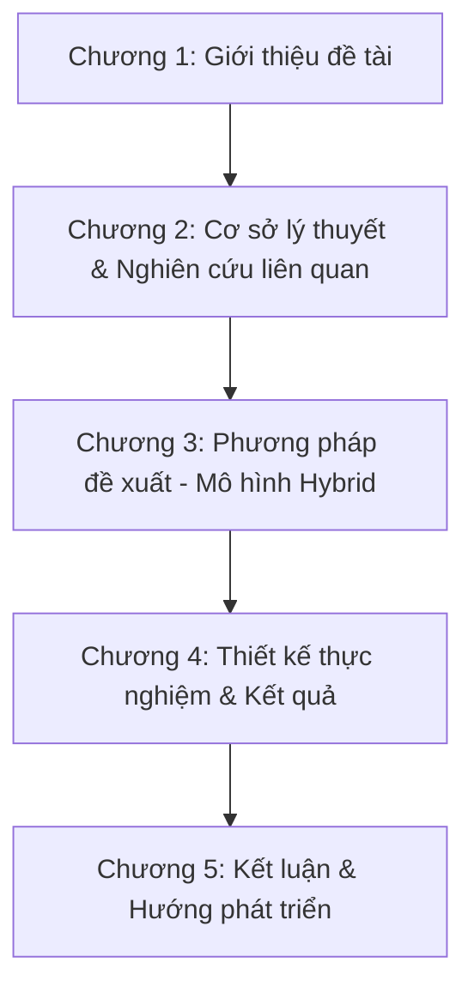
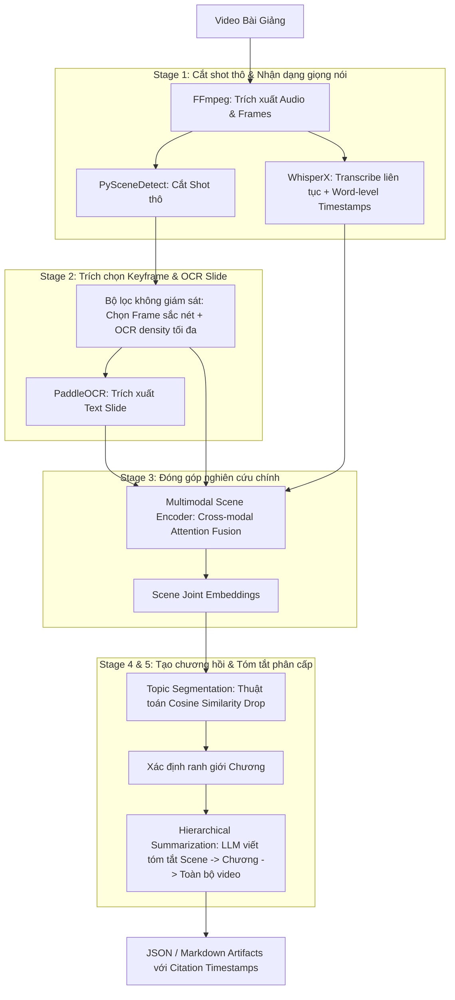
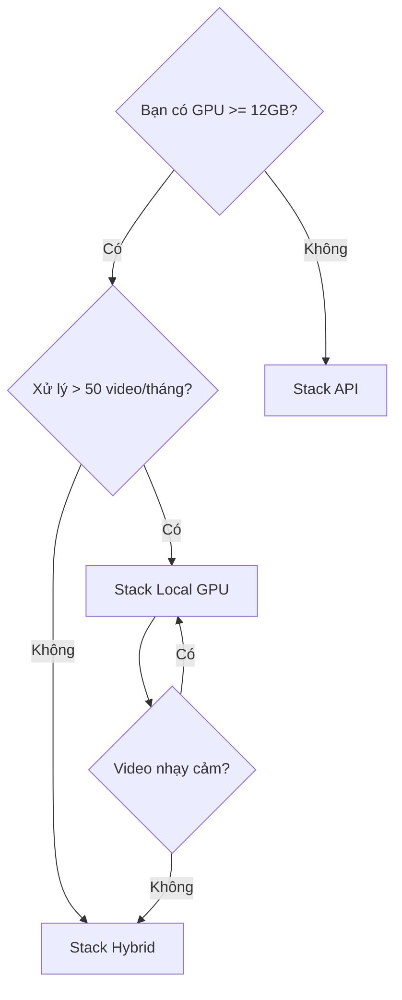

# Hồ sơ chiến lược nghiên cứu (lưu trữ)

Tập hợp nguyên văn bốn tài liệu định hướng lịch sử. Mỗi phần giữ tên và SHA-256 của tệp nguồn.

## Nguồn

- POTENTIAL_RESEARCH_TRENDS.md — SHA-256 3c486593335ae5c0f383e3af73a344b3e2c06a2c101045953f0687342de7bad4
- RESEARCH_DIRECTIONS.md — SHA-256 728f490da659588b161d47033b717fcb40188783412f1b776290d1be42be36af
- ROADMAP_EVALUATION.md — SHA-256 998a1d4e5db8b1dea19973f8c57daf684de58ddd1839f74d64d47f54252d8280
- STACK_COMPARISON.md — SHA-256 35a36bc4810c69832e73ff9037095e3efc88c73387f1b8f54d71a3692318d04a

---

## Nguồn: POTENTIAL_RESEARCH_TRENDS.md

# Các Hướng Phát Triển & Mở Rộng Tiềm Năng Trong Lĩnh Vực Tóm Tắt Video Đa Phương Thức

Tài liệu này đề xuất và phân tích các hướng đi tiên phong (cutting-edge research directions) trong lĩnh vực **Multimodal Video Processing & Summarization**. Đây là những hướng nghiên cứu đang được quan tâm lớn tại các hội nghị AI hàng đầu (CVPR, ACL, NeurIPS, KDD) và có thể phát triển thành các bài báo khoa học chất lượng cao hoặc mở rộng luận văn lên bậc học cao hơn (PhD/Postdoc).

---

## Phạm Vi Nghiên Cứu và Giới Hạn Đề Tài (Research Scope & Limitations)

Khi xây dựng đề cương, nghiên cứu hoặc báo cáo khoa học, việc xác định rõ ràng phạm vi đối tượng nghiên cứu là cực kỳ quan trọng để đảm bảo tính khả thi và tập trung của đề tài:

*   **Đối tượng video (Single-Character / Single-Speaker Focus):**
    *   **Phạm vi áp dụng:** Chỉ tập trung nghiên cứu trên các video có **một nhân vật chính / một người nói chính** (ví dụ: video bài giảng solo, video thuyết trình, hướng dẫn kỹ thuật trực tuyến, hoặc các buổi webinar một diễn giả thuyết trình).
    *   **Loại trừ:** Không xử lý và phân tích các video có nhiều nhân vật tương tác phức tạp (như phim điện ảnh, phim truyền hình, talkshow tranh luận nhiều người, họp nhóm trực tuyến). Điều này giúp giảm thiểu độ phức tạp trong việc nhận diện/phân đoạn nhân vật, theo dõi khuôn mặt chéo hoặc phân tách giọng nói của nhiều người khác nhau.
*   **Đặc trưng và khía cạnh xử lý giới hạn:**
    *   **Tập trung vào tính chất truyền tải thông tin (Informative/Educational properties):** Nghiên cứu chủ yếu khai thác sự căn chỉnh đồng bộ giữa các luồng thông tin: Lời nói (Transcript) $\leftrightarrow$ Trực quan (Slide OCR, Bảng viết tay) $\leftrightarrow$ Tiến trình thời gian (Timeline).
    *   **Giới hạn khía cạnh phân tích:** Đề tài tập trung vào việc trích xuất và tóm tắt nội dung tri thức, công thức, thực thể ngữ nghĩa; **không cần bám vào tất cả khía cạnh phi ngữ nghĩa** như:
        *   Phân tích hành vi cử chỉ cơ thể phức tạp (complex body action recognition).
        *   Nhận diện cảm xúc sâu (micro-expression sentiment analysis).
        *   Phân tích nghệ thuật quay dựng phim (cinematography, góc quay camera).
    *   **Đầu ra cốt lõi:** Sinh đồ thị tri thức bài giảng, tóm tắt/cá nhân hóa tóm tắt, căn chỉnh đa ngôn ngữ, và phát hiện điểm bất nhất giữa Slide và Transcript của nhân vật đó.

---


## 1. Tóm tắt Tương tác và Cá nhân hóa (Personalized & Interactive Summarization)

*   **Ý tưởng cốt lõi:** Thay vì tạo ra một bản tóm tắt tĩnh duy nhất cho mọi người dùng, hệ thống sẽ điều chỉnh bản tóm tắt và cấu trúc chương mục dựa trên **Hồ sơ người dùng (User Profile)** và **Ngữ cảnh tương tác (Interactive Q&A)**.
*   **Chi tiết nghiên cứu:**
    *   *Cá nhân hóa theo trình độ:* Một học sinh phổ thông cần bản tóm tắt trực quan, dễ hiểu với nhiều ví dụ; trong khi một nhà nghiên cứu cần bản tóm tắt học thuật sâu sắc, chứa các công thức toán học và mã nguồn.
    *   *Cá nhân hóa theo mục tiêu:* Tóm tắt nhanh trước kỳ thi (Cheat Sheet) vs. Tóm tắt phục vụ nghiên cứu sâu (Literature Review).
*   **Thử thách khoa học:**
    *   Thiết kế bộ mã hóa hồ sơ người dùng (User Persona Encoder) dưới dạng vector embedding để điều khiển (steer) decoder của mô hình sinh tóm tắt.
    *   Xây dựng hệ thống Multimodal RAG (Retrieval-Augmented Generation) có khả năng định vị chính xác cả mốc thời gian hình ảnh (timestamp) và đoạn văn bản liên quan để giải thích câu hỏi của người học.
*   **Nghiên cứu tiêu biểu & SOTA:**
    *   **LLMVS (CVPR 2025):** *Video Summarization with Large Language Models* – Sử dụng Multimodal LLM để đánh giá mức độ quan trọng của các frame dựa trên ngữ cảnh cục bộ và toàn cục, hỗ trợ cá nhân hóa qua gợi ý prompt.
    *   **PersonalSum (NeurIPS 2024):** *PersonalSum: A User-Subjective Guided Personalized Summarization Dataset for Large Language Models* – Benchmark đánh giá tóm tắt cá nhân hóa dựa trên góc nhìn chủ quan và nhu cầu riêng của người dùng.
    *   **CLIP-It! (CVPR):** *Language-Guided Video Summarization* – Mô hình nền tảng sử dụng multimodal transformer hỗ trợ tóm tắt video theo câu lệnh/truy vấn của người dùng.
    *   **SAMA (CVPR/NeurIPS), VSTAR (ACL), DVD (ACL):** Các bộ dữ liệu lớn phục vụ bài toán Video-Grounded Dialogue, hỗ trợ hỏi đáp nhiều lượt (multi-turn) dựa trên nội dung video.

---

## 2. Sinh Đồ thị Tri thức từ Video Bài giảng (Video-to-Knowledge-Graph)

*   **Ý tưởng cốt lõi:** Chuyển đổi cấu trúc tuyến tính của video (timeline chạy từ 0 đến kết thúc) thành một cấu trúc đồ thị phi tuyến tính biểu diễn **Đồ thị Tri thức bài học (Lecture Knowledge Graph)**.
*   **Chi tiết nghiên cứu:**
    *   Các slide và đoạn hội thoại sẽ được phân tích để trích xuất các **Thực thể Tri thức (Knowledge Entities)** (ví dụ: "Gradient Descent", "Loss Function", "Learning Rate").
    *   Mô hình sẽ học cách dự đoán **Quan hệ ngữ nghĩa (Semantic Relations)** giữa các thực thể, chẳng hạn như:
        *   `Loss Function` $\rightarrow$ *[is_a_parameter_of]* $\rightarrow$ `Gradient Descent`.
        *   `Linear Algebra` $\rightarrow$ *[is_prerequisite_for]* $\rightarrow$ `Machine Learning`.
*   **Thử thách khoa học:**
    *   Trích xuất quan hệ đa phương thức (Multimodal Relation Extraction): Nhận biết quan hệ thực thể không chỉ qua văn bản nói mà qua sơ đồ, hình vẽ mũi tên trên slide (Visual Relation).
    *   Đánh giá chất lượng đồ thị tự động và trực quan hóa cấu trúc tri thức động cho người học.
*   **Nghiên cứu tiêu biểu & SOTA:**
    *   **AMPKG (OpenReview 2026):** *AMPKG: Evidence-Weighted Multimodal Educational Knowledge Graph* – Chuyển đổi video bài giảng (gồm transcript, slide, và hình ảnh) thành một "curriculum graph" (đồ thị chương trình học), sử dụng các đơn vị bằng chứng (evidence units) để hạn chế lỗi ảo tưởng (hallucination) của LLMs.
    *   **SVGraph (2022):** *Learning Semantic Graphs from Instructional Videos* – Mô hình hóa chuỗi hoạt động trong video dưới dạng đồ thị ngữ nghĩa động thời gian để nhận diện các bước giảng dạy/thực hiện.
    *   **Detection-Fusion Framework (2024/2025):** Các mô hình tích hợp nhận diện vật thể/khái niệm hình ảnh và transcript để tự động trích xuất các bộ ba thực thể-quan hệ (triplets) cấu thành đồ thị tri thức có khả năng truy vấn.

---

## 3. Dung hợp Đa ngôn ngữ và Dịch thuật Bài giảng (Cross-lingual Multimodal Alignment)

*   **Ý tưởng cốt lõi:** Xử lý các bài giảng được giảng dạy bằng một ngôn ngữ (ví dụ: tiếng Anh) nhưng tạo ra tài liệu tóm tắt, OCR và mục lục bằng một ngôn ngữ khác (ví dụ: tiếng Việt) một cách đồng bộ.
*   **Chi tiết nghiên cứu:**
    *   Thay vì dịch từng bước độc lập (dịch text OCR, dịch transcript riêng lẻ - dễ dẫn đến lệch ngữ nghĩa và lệch pha thời gian), hệ thống sẽ chiếu tất cả các modalities của các ngôn ngữ khác nhau vào một **Không gian Biểu diễn Đa ngôn ngữ Chung (Shared Multilingual Latent Space)**.
*   **Thử thách khoa học:**
    *   Sử dụng các mô hình pre-trained đa ngôn ngữ như **mCLIP**, **XLM-RoBERTa** để trích xuất embeddings, sau đó huấn luyện mạng Cross-lingual Attention Alignment.
    *   Đảm bảo các thuật ngữ chuyên ngành (terminology) được dịch chính xác và thống nhất giữa Slide OCR và Transcript.
*   **Nghiên cứu tiêu biểu & SOTA:**
    *   **MCLS for How2 Videos (ACL):** *Assist Non-native Viewers: Multimodal Cross-Lingual Summarization for How2 Videos* – Đề xuất mô hình **VDF (Video-guided Dual Fusion) network** và framework huấn luyện 3 giai đoạn sử dụng chưng cất tri thức (Knowledge Distillation) để xử lý việc tóm tắt đa phương thức xuyên ngôn ngữ (English video $\rightarrow$ Portuguese/Vietnamese summary).
    *   Các kỹ thuật căn chỉnh dựa trên không gian biểu diễn chung (Shared Latent Space) tận dụng các mô hình pre-trained như mCLIP và XLM-R để đồng bộ hóa cả giọng nói, văn bản OCR và nhãn tóm tắt.

---

## 4. Hiểu Bài giảng Viết bảng và Vẽ tay (Whiteboard & Handwritten Lecture Understanding)

*   **Ý tưởng cốt lõi:** Hầu hết các hệ thống hiện tại (bao gồm cả hệ thống hiện tại của bạn) hoạt động tốt khi slide bài giảng là slide kỹ thuật số (PDF, PowerPoint) sạch sẽ. Tuy nhiên, một lượng lớn bài giảng khoa học tự nhiên (Toán, Lý, Hóa) được giảng dạy trên bảng đen/bảng trắng bằng chữ viết tay và hình vẽ phác thảo.
*   **Chi tiết nghiên cứu:**
    *   Nhận diện chữ viết tay trên bảng (Handwritten Text Recognition - HTR) từ chuỗi video động.
    *   Nhận diện và số hóa công thức toán học viết tay (Mathematical Expression Recognition).
    *   Phân tích hành vi giảng viên: Nhận diện cử chỉ chỉ tay (pointing gesture) để liên kết lời nói với phần bảng viết tương ứng.
*   **Thử thách khoa học:**
    *   Xử lý hiện tượng che khuất (occlusion) khi giảng viên đứng chắn trước bảng.
    *   Sự thay đổi liên tục của chữ viết bảng (giảng viên viết thêm, xóa bớt, vẽ đè lên hình cũ).
*   **Nghiên cứu tiêu biểu & SOTA:**
    *   **FCN-LectureNet:** *Fully Convolutional Sequence Networks for Lecture Video Summarization* – Tách biệt và trích xuất thông tin viết tay trên bảng trắng/bảng đen bằng mạng FCN dưới dạng các ảnh nhị phân sạch, giải quyết bài toán instructor occlusion.
    *   **Mathematical Expression Recognition (MER) in Videos:** Các thuật toán nhận dạng và dịch chuyển các công thức toán học viết tay từ video bài giảng sang định dạng có thể tìm kiếm (như LaTeX) thay vì chỉ lưu text tuyến tính.
    *   **Tập dữ liệu AccessMath & LectureMath:** Các tập dữ liệu benchmark tiêu chuẩn cho việc nhận diện chữ viết tay và công thức viết bảng trong môi trường học thuật thực tế.

---

## 5. Tóm tắt Luồng Thời gian thực (Streaming & Edge-AI Summarization)

*   **Ý tưởng cốt lõi:** Thay vì đợi video kết thúc (offline processing) mới tiến hành tóm tắt, hệ thống sẽ thực hiện tóm tắt và cập nhật mục lục liên tục theo thời gian thực (real-time streaming) khi bài giảng đang diễn ra.
*   **Chi tiết nghiên cứu:**
    *   Ứng dụng trong các buổi livestream học trực tuyến, hội thảo trực tuyến (Zoom, MS Teams) để cung cấp bản tóm tắt tức thời cho những người tham gia muộn.
*   **Thử thách khoa học:**
    *   Thiết kế bộ nhớ trượt (Sliding Window / Memory Bank Attention) để lưu trữ thông tin lịch sử của bài giảng mà không làm bùng nổ bộ nhớ GPU/VRAM.
    *   Thuật toán cập nhật đồ thị tri thức và tóm tắt động: Khi thông tin mới xuất hiện, làm thế nào để cập nhật bản tóm tắt cũ mà không cần chạy lại toàn bộ mô hình từ đầu.
*   **Nghiên cứu tiêu biểu & SOTA:**
    *   **StreamFormer (ICCV 2025):** *Learning Streaming Video Representation via Multitask Training* – Backbone xử lý video theo thời gian thực (streaming) với ràng buộc độ trễ thấp (low-latency constraints).
    *   **Quasi Real-Time Summarization (CVPR):** Nghiên cứu sử dụng kỹ thuật cập nhật từ điển động (online dictionary learning) dựa trên Group Sparse Coding để tóm tắt các luồng video gần như song song với thời gian thực.
    *   Các mô hình sequence networks sử dụng bộ nhớ đệm sliding-window hoặc memory bank attention được phát triển để xử lý luồng video dài mà không vượt quá giới hạn GPU VRAM.

---

## 6. Tự động Kiểm chứng Thông tin và Sửa lỗi (Multimodal Fact-Checking & Self-Correction)

*   **Ý tưởng cốt lõi:** Giảng viên đôi khi nói nhầm hoặc viết nhầm trên slide. Một hệ thống AI thông minh phải có khả năng đối chiếu chéo (Cross-verification) giữa nội dung văn bản chuẩn trên slide và lời nói của giảng viên để phát hiện và cảnh báo các điểm mâu thuẫn.
*   **Chi tiết nghiên cứu:**
    *   Nếu slide ghi công thức là $a^2 + b^2 = c^2$ nhưng giảng viên nói nhầm là "a bình trừ b bình bằng c bình", hệ thống cần phát hiện ra sự không nhất quán này dựa trên cơ chế Cross-modal Attention và ghi chú lại trong bản tóm tắt: *"Giảng viên nói nhầm tại thời điểm [MM:SS], công thức đúng trên slide là..."*.
*   **Thử thách khoa học:**
    *   Xây dựng mô hình lập luận đa phương thức (Multimodal Reasoning) có khả năng phát hiện lỗi logic logic giữa thị giác và thính giác.
    *   Đo lường độ tin cậy của nguồn tin (Slide thường có độ tin cậy cao hơn lời nói ngẫu hứng).
*   **Nghiên cứu tiêu biểu & SOTA:**
    *   **VMD-FACT (CVPR 2026):** *Interpretable Evidence-based Evidence Graph for Video Misinformation Detection* – Sử dụng đồ thị bằng chứng đa phương thức để phát hiện sự mâu thuẫn hoặc sai lệch thông tin trong video.
    *   **FACTIFY 3M (ACL Anthology):** Tập dữ liệu 3 triệu mẫu dùng cho kiểm chứng thông tin đa phương thức (multimodal fact verification), giải quyết bài toán đối chiếu chéo giữa văn bản, hình ảnh và nguồn tri thức ngoài.
    *   **TRENT (ECCV 2026) & DEFAME:** Các framework sử dụng cơ chế Cross-attention song song (Parallel Cross-attention Streams) hoặc RAG đa phương thức để xác minh tính đúng đắn giữa nội dung trình bày trực quan và lời thoại tương ứng.

---

## Nguồn: RESEARCH_DIRECTIONS.md

# Đề Cương Thiết Kế Nghiên Cứu & Kịch Bản Thử Nghiệm (Multimodal Lecture Summarizer)

Tài liệu này đóng vai trò là khung lý thuyết và thực nghiệm (empirical framework) phục vụ cho việc viết đề cương, báo cáo tiến độ và viết chương **Thực nghiệm & Đánh giá (Experiments & Evaluation)** của luận văn tốt nghiệp / đề tài nghiên cứu.

---

## 1. Các Câu hỏi Nghiên cứu Cốt lõi (Core Research Questions - RQs)

Để đề tài có tính thuyết phục khoa học, toàn bộ quá trình thực nghiệm và các bài toán cần phải tập trung trả lời 3 câu hỏi nghiên cứu chính dưới đây:

*   **RQ1 (Hiệu quả Dung hợp Đa phương thức):** Cơ chế Cross-modal Attention kết hợp đặc trưng hình ảnh (Keyframe), văn bản slide (OCR) và lời thoại (Transcript) cải thiện độ chính xác trong việc phân đoạn ngữ nghĩa và định vị chủ đề bài học như thế nào so với việc chỉ sử dụng đơn lẻ một phương thức (Single-modality)?
*   **RQ2 (Giải quyết ảo tưởng bằng Tóm tắt Phân cấp):** Phương pháp tóm tắt phân cấp (Hierarchical Summarization) dựa trên cấu trúc scene/chapter giúp tăng tính chân thực (factual consistency) và giảm hiện tượng ảo tưởng (hallucination) của LLM như thế nào đối với các bài giảng siêu dài (> 60 phút) so với phương pháp tóm tắt phẳng (Flat Summarization - đưa toàn bộ transcript vào LLM)?
*   **RQ3 (Bài toán tối ưu Hiệu năng & Chi phí):** Kiến trúc Hybrid (Local Feature Extraction + Custom Fusion Layer + Lightweight Summarizer) đạt được sự cân bằng (trade-off) như thế nào về độ chính xác, thời gian xử lý (latency) và chi phí tài nguyên tính toán (VRAM, API token cost) so với các mô hình Video-Language lớn (Video-LLMs) chạy end-to-end?

---

## 2. Thiết kế Thử nghiệm Nghiên cứu Suy hao (Ablation Studies)

Nghiên cứu suy hao (Ablation Study) là phần bắt buộc trong các bài báo khoa học hàng đầu để chứng minh vai trò đóng góp của từng thành phần trong mô hình lai (Hybrid model).

### Thử nghiệm 1: Đánh giá vai trò của các Modalities (Đặc trưng đầu vào)
Bạn cần huấn luyện các phiên bản mô hình bị lược bỏ các nhánh đầu vào khác nhau và đo lường độ chính xác của vector biểu diễn scene thu được (đánh giá gián tiếp qua tác vụ phân đoạn chương hoặc phân loại chủ đề).

| Tên Mô hình | Nhánh Visual (CLIP) | Nhánh OCR (PaddleOCR) | Nhánh Transcript (Whisper) | Mục tiêu chứng minh |
| :--- | :---: | :---: | :---: | :--- |
| **M1 (Baseline Text)** | ❌ | ❌ |  (PhoBERT) | Đánh giá mức độ hiệu quả khi chỉ nghe giảng viên nói (không có slide). |
| **M2 (Visual + Text)** |  | ❌ |  | Đo lường ảnh hưởng khi thiếu thông tin chữ viết chi tiết trên slide. |
| **M3 (OCR + Text)** | ❌ |  |  | Đo lường ảnh hưởng khi thiếu thông tin trực quan (hình vẽ, sơ đồ). |
| **M4 (Proposed Hybrid)**|  |  |  | **Mô hình đề xuất đầy đủ.** |

### Thử nghiệm 2: So sánh các cơ chế Dung hợp (Fusion Mechanisms)
So sánh cơ chế **Cross-modal Attention** đề xuất của bạn với các phương pháp dung hợp đặc trưng kinh điển khác:
*   **Early Fusion (Concatenation):** Ghép nối trực tiếp các vector đặc trưng lại với nhau rồi đi qua một mạng tuyến tính đơn giản: $z = W[v; o; t] + b$.
*   **Late Fusion (Average Pooling):** Chiếu các vector về cùng số chiều rồi lấy trung bình cộng: $z = \frac{v' + o' + t'}{3}$.
*   **Cross-modal Attention (Đề xuất):** Dùng đặc trưng visual làm Query để trích xuất có chọn lọc các thông tin văn bản phù hợp nhất từ slide và transcript.

---

## 3. So sánh đối chứng (Comparative Analysis) với SOTA

Để làm nổi bật giá trị của hệ thống, bạn cần chọn đối thủ so sánh (Baselines) là các mô hình SOTA hiện nay:

1.  **So sánh với Pipeline truyền thống:** Sử dụng PySceneDetect thô + trích xuất keyframe mặc định + gọi LLM tóm tắt thẳng không phân cấp.
2.  **So sánh với SOTA Video-LLMs (End-to-End):** Chạy trực tiếp các mô hình Video-Language Models mạnh mẽ như **Qwen2-VL** hoặc **LLaVA-NeXt-Video** để tóm tắt video.
    *   *Tiêu chí so sánh:*
        *   **Độ chính xác của Chương (Chaptering Accuracy):** Sai lệch timestamp (giây) giữa chương tự động tạo so với nhãn của con người.
        *   **Factuality:** Số lượng thông tin bịa đặt (hallucinations) trong bản tóm tắt.
        *   **VRAM Utilization:** Lượng VRAM sử dụng (GB) khi chạy.
        *   **Processing Latency:** Thời gian cần để xử lý 1 giờ video.

---

## 4. Hệ thống Chỉ số Đánh giá (Evaluation Metrics)

Khi viết phần kết quả nghiên cứu, bạn cần sử dụng các chỉ số toán học chuẩn đã được quốc tế công nhận:

### A. Đánh giá phân đoạn chương hồi (Video Chaptering)
Để so sánh ranh giới chương tự động tạo với nhãn do con người gán (Ground Truth), sử dụng các metric sau:
*   **$P_k$ Metric (Beeferman et al., 1999):** Chỉ số đo lường xác suất một phân đoạn ngẫu nhiên bị phân lớp sai. Điểm $P_k$ càng thấp thì mô hình phân chia chương càng khớp với con người.
*   **WindowDiff (Pevzner & Hearst, 2002):** Bản cải tiến của $P_k$, khắc phục nhược điểm nhạy cảm với mật độ ranh giới. Đây là chỉ số chuẩn mực trong tác vụ Topic Segmentation hiện nay.
*   **Precision, Recall, F1-score (với dung sai $\delta$):** Ví dụ cho phép sai số $\delta = \pm 15$ giây hoặc $\pm 30$ giây xung quanh ranh giới chương chuẩn.

### B. Đánh giá chất lượng bản tóm tắt (Summarization)
*   **ROUGE-1, ROUGE-2, ROUGE-L:** Đo lường tỉ lệ trùng khớp từ đơn, từ đôi và chuỗi con chung dài nhất giữa bản tóm tắt máy sinh ra và bản tóm tắt của con người.
*   **BERTScore:** Sử dụng contextual embeddings của RoBERTa/PhoBERT để tính độ tương đồng ngữ nghĩa giữa các câu, tránh việc phạt mô hình khi sử dụng các từ đồng nghĩa mà ROUGE thường mắc phải.
*   **G-Eval (GPT-4o Evaluation):** Phương pháp đánh giá sử dụng LLM cấu hình prompt đóng vai trò chuyên gia đánh giá theo 4 tiêu chí (thang điểm 1-5):
    1.  *Coherence (Tính liên kết):* Bản tóm tắt có cấu trúc logic tốt không?
    2.  *Consistency (Tính nhất quán):* Bản tóm tắt có bịa đặt ra thông tin ngoài video không?
    3.  *Fluency (Sự trôi chảy):* Câu từ có tự nhiên không?
    4.  *Relevance (Tính liên quan):* Có giữ lại được các ý chính của bài giảng không?

---

## 5. Cấu trúc Chương Nghiên cứu đề xuất cho Luận văn

Dưới đây là khung dàn ý gợi ý giúp bạn viết luận văn học thuật một cách có hệ thống:



### Chi tiết các chương:

*   **Chương 1: Giới thiệu (Introduction)**
    *   Đặt vấn đề: Sự bùng nổ của video bài giảng trực tuyến (E-learning) và khó khăn của người học khi tiếp thu video dài.
    *   Mục tiêu đề tài và giới hạn nghiên cứu.
*   **Chương 2: Cơ sở lý thuyết & Nghiên cứu liên quan (Literature Review)**
    *   Phân tích các công trình về: Nhận dạng giọng nói (ASR), Xử lý ảnh bài giảng (OCR, Keyframe extraction), và Tóm tắt văn bản.
    *   Đi sâu phân tích cơ chế Cross-modal Attention và các kiến trúc dung hợp SOTA. Chỉ ra khoảng trống nghiên cứu (gap): Các mô hình lớn tốn tài nguyên và dễ ảo tưởng trên video bài giảng dài.
*   **Chương 3: Phương pháp đề xuất (Proposed Methodology)**
    *   Mô tả tổng quan kiến trúc hệ thống Hybrid.
    *   Toán học hóa cơ chế **Multimodal Scene Encoder**: Chi tiết các lớp Projection, kiến trúc Multi-head Cross-modal Attention, Residual layers.
    *   Mô tả thuật toán tự giám sát Contrastive Loss sử dụng để huấn luyện bộ encoder.
    *   Thiết kế thuật toán phân đoạn chương hồi và tóm tắt phân cấp.
*   **Chương 4: Thực nghiệm & Đánh giá (Experiments & Results)**
    *   Mô tả tập dữ liệu (dataset) tự thu thập hoặc các dataset public.
    *   Kết quả các bài thử nghiệm Ablation Study (RQ1).
    *   Kết quả đối chứng chất lượng tóm tắt (ROUGE, BERTScore, G-Eval) (RQ2).
    *   Kết quả đánh giá tốc độ và tài nguyên tiêu hao (RQ3).
*   **Chương 5: Kết luận (Conclusion & Future Work)**
    *   Tóm tắt các đóng góp khoa học chính.
    *   Các hạn chế hiện tại của mô hình Hybrid và hướng giải quyết trong tương lai (ví dụ: cá nhân hóa tóm tắt, hỗ trợ đa ngôn ngữ tốt hơn).

---

## Nguồn: ROADMAP_EVALUATION.md

# Đánh giá Lộ trình Triển khai & Khảo sát Mô hình SOTA (Multimodal Lecture Summarizer)

Tài liệu này đánh giá tính khả thi của lộ trình phát triển hệ thống **Tóm tắt bài giảng đa phương thức (Multimodal Lecture Summarizer)** phục vụ cho mục tiêu nghiên cứu làm luận văn/đề tài. Đồng thời, tài liệu cung cấp khảo sát chi tiết về ưu/nhược điểm của các mô hình đã được công bố trên các tạp chí và hội nghị khoa học lớn (CVPR, ICCV, ECCV, ACL, EMNLP, TPAMI).

---

## 1. Đánh giá tổng quan tính khả thi (Executive Summary)

Lộ trình 5 bước được đề xuất có cấu trúc logic rất chặt chẽ và bao phủ toàn diện các thành phần của một hệ thống xử lý video đa phương thức. Điểm nhấn nghiên cứu (**Multimodal Scene Encoder** kết hợp với **Hierarchical Summarization**) là một hướng đi rất triển vọng, có giá trị học thuật cao và đủ độ mới (novelty) để làm trọng tâm cho đồ án tốt nghiệp hoặc bài báo khoa học.

Tuy nhiên, trong khuôn khổ thời gian giới hạn của một luận văn (thường từ 6–12 tháng) và tài nguyên tính toán cá nhân, việc **tự huấn luyện từ đầu (self-train from scratch)** toàn bộ 5 mô hình/mạng mạng thần kinh là **cực kỳ rủi ro và thiếu khả thi**. 

### Các thách thức cốt lõi:
1. **Thiếu hụt dữ liệu gán nhãn chuẩn (Data Bottleneck):** Các tác vụ như phân đoạn cảnh (Scene Segmentation) hay chọn khung hình khóa (Keyframe Selection) trên video bài giảng chưa có các bộ dữ liệu benchmark lớn tương đương như phim ảnh (MovieNet). Việc tự gán nhãn hàng trăm giờ video bài giảng thủ công sẽ chiếm đến 70% thời gian thực hiện đề tài.
2. **Chi phí tính toán (Compute Cost):** Huấn luyện các mô hình học sâu xử lý video (3D CNNs, Video Transformers) yêu cầu hạ tầng GPU rất lớn (A100/H100) và thời gian hội tụ lâu.

### Đề xuất chiến lược (Hybrid Approach):
> [!TIP]
> **Giữ nguyên mục tiêu nghiên cứu nhưng thay đổi phương pháp thực hiện:** 
> - **Đóng băng (Freeze) các bộ trích xuất đặc trưng (Backbones) mạnh đã được huấn luyện trước (Pre-trained SOTA)** như CLIP, WhisperX, PaddleOCR để trích xuất các đặc trưng biểu diễn (embeddings/texts).
> - **Tập trung huấn luyện (Train/Fine-tune) bộ gom tụ và cơ chế Fusion:** Thiết kế và huấn luyện mạng **Multimodal Scene Encoder** (dùng Cross-modal Attention) để dung hợp các đặc trưng này. Đây sẽ là phần đóng góp code chính và là trung tâm của các thử nghiệm (ablation studies).
> - **Ứng dụng Heuristics/Unsupervised cho các khâu phụ trợ:** Dùng thuật toán không giám sát hoặc bộ luật (rule-based) để phân đoạn cảnh thô và chọn keyframe, từ đó loại bỏ hoàn toàn bước gán nhãn thủ công cho các khâu này.

---

## 2. Phân tích tính khả thi & Rủi ro từng giai đoạn

Dưới đây là bảng phân tích chi tiết mức độ khả thi và giải pháp khắc phục cho từng bước trong lộ trình đề xuất:

### Giai đoạn 1: Tự huấn luyện mô hình Scene Segmentation để chia video bài giảng
* **Mức độ khả thi:** **Trung bình - Thấp (Medium-Low)** nếu huấn luyện mô hình học sâu từ đầu. **Cao (High)** nếu sử dụng giải pháp Hybrid.
* **Rủi ro chính:** Video bài giảng có tính chất hình học rất khác biệt so với phim ảnh hay video đời thường. Cảnh phim có nhiều cú cắt (hard cut) hoặc hiệu ứng chuyển cảnh rõ rệt. Bài giảng thường chỉ có slide tĩnh chiếm phần lớn màn hình, giảng viên đứng một góc, chuyển cảnh thực chất là chuyển slide (diễn ra rất chậm hoặc chỉ thay đổi một phần chữ). Huấn luyện một mô hình deep learning tự phát hiện ranh giới ngữ nghĩa (semantic scene) từ raw video rất khó hội tụ nếu không có hàng ngàn video bài giảng gán nhãn tỉ mỉ.
* **Giải pháp khuyến nghị:** 
  - Bước 1: Sử dụng **PySceneDetect (ContentDetector/Threshold)** để phát hiện các điểm thay đổi visual thô (các shot hình).
  - Bước 2: Dùng mô hình **CLIP** trích xuất embedding của các frame đầu/cuối mỗi shot. Nếu cosine similarity giữa 2 shot liên tiếp > 0.90, gộp chúng lại.
  - Bước 3: Kết hợp thông tin ngắt nghỉ từ transcript (câu thoại kếtthuốc) để tinh chỉnh ranh giới. Phương pháp này đạt độ chính xác tương đương mô hình học sâu nhưng tốn 0 giờ gán nhãn.

### Giai đoạn 2: Tự huấn luyện Keyframe Selection Network để chọn khung hình quan trọng
* **Mức độ khả thi:** **Trung bình (Medium)**.
* **Rủi ro chính:** Việc định nghĩa thế nào là một keyframe "quan trọng" trong bài giảng mang tính chủ quan. Một mạng supervised keyframe selection (như VASNet) cần gán nhãn tầm quan trọng của từng frame (score từ 0 đến 1), việc này tốn rất nhiều công sức và khó tổng quát hóa.
* **Giải pháp khuyến nghị:** Đối với bài giảng, một keyframe chất lượng cao phải thỏa mãn:
  1. Không bị nhòe hình (độ sắc nét cao - Sharpness).
  2. Chứa nhiều thông tin bài học nhất (mật độ ký tự OCR cao nhất).
  3. Không bị che khuất bởi giảng viên (nếu có giảng viên di chuyển trước slide).
  -> Thiết kế một thuật toán không giám sát: Cắt video theo scene ranh giới ở Giai đoạn 1. Với mỗi scene, chạy OCR (PaddleOCR) trên một vài frame ứng viên, chọn frame có **số lượng ký tự OCR nhiều nhất và rõ ràng nhất** làm đại diện. Điều này đảm bảo LLM sau đó có đủ dữ liệu slide tốt nhất để tóm tắt.

### Giai đoạn 3: Xây dựng Multimodal Scene Encoder bằng Cross-modal Attention
* **Mức độ khả thi:** **Rất cao (Very High - Trọng tâm khoa học)**.
* **Đóng góp học thuật:** Đây là điểm sáng của đề tài. Bạn sẽ thiết kế một kiến trúc mạng (ví dụ sử dụng PyTorch) nhận vào 3 nhánh đặc trưng (modalities) đã được trích xuất sẵn:
  - **Visual:** Vector biểu diễn slide keyframe từ CLIP ViT.
  - **Acoustic/Speech:** Vector biểu diễn giọng nói hoặc BERT embedding của đoạn transcript tương ứng với scene đó.
  - **OCR Text:** BERT/RoBERTa embedding của toàn bộ văn bản OCR trích xuất được từ slide.
  Áp dụng cơ chế **Cross-modal Attention (như trong mô hình MulT - ACL 2019)** để cho phép các modality tương tác và căn chỉnh chéo với nhau. Đầu ra là một **Scene Joint Embedding** chứa đầy đủ tri thức của phân đoạn đó.
* **Cách huấn luyện khả thi:**
  - Cách A (Self-supervised): Huấn luyện contrastive learning để khớp cặp (Scene Embedding, Transcript Embedding).
  - Cách B (Task-oriented): Dùng Scene Joint Embedding này làm đầu vào cho một bộ phân loại (Classifier) để dự đoán chủ đề của phân đoạn bài giảng (học có giám sát trên một tập dữ liệu nhỏ dễ gán nhãn hơn nhiều).

### Giai đoạn 4: Thiết kế Hierarchical Summarization (Scene-level -> Video-level)
* **Mức độ khả thi:** **Rất cao (Very High)**.
* **Đóng góp học thuật:** Phương pháp tóm tắt phân cấp giải quyết xuất sắc điểm yếu về giới hạn cửa sổ ngữ cảnh (context window limits) và hiện tượng "lost in the middle" của các mô hình LLM khi tóm tắt tài liệu siêu dài.
* **Phương pháp thực hiện:**
  - **Scene Summary (Tóm tắt cục bộ):** Gửi transcript của từng scene kèm text OCR của slide đó vào LLM (ví dụ GPT-4o-mini hoặc Llama-3-8B local) để viết tóm tắt ngắn cho scene (ví dụ 3-5 gạch đầu dòng, có citation timestamp chính xác).
  - **Global Summary (Tóm tắt toàn cục):** Tổng hợp tất cả các bản tóm tắt scene lại, kết hợp với cấu trúc phân cấp để LLM tạo ra cấu trúc chương hồi tổng thể và tóm tắt toàn bộ bài học.
  Cách tiếp cận này rất dễ thực hiện bằng LangChain/LlamaIndex hoặc lập trình Prompt trực tiếp, đem lại hiệu quả thực tiễn cực kỳ cao.

### Giai đoạn 5: Huấn luyện Chapter Generation dựa trên Scene Embedding
* **Mức độ khả thi:** **Trung bình (Medium)**.
* **Rủi ro chính:** Việc tự huấn luyện một mạng neural để dự đoán ranh giới chương (chapter boundary) đòi hỏi dữ liệu huấn luyện lớn và nhãn chương nhất quán.
* **Giải pháp khuyến nghị:** 
  - Thay vì huấn luyện mạng học sâu phức tạp, hãy áp dụng thuật toán phân đoạn chủ đề cổ điển nhưng mạnh mẽ: **Topic Segmentation (ví dụ: TextTiling cải tiến)**. Tính toán độ tương đồng cosine giữa các vector **Scene Embedding** liên tiếp (được sinh ra từ Giai đoạn 3). Điểm tương đồng giảm mạnh (cosine similarity drop) vượt quá một ngưỡng (threshold) chính là ranh giới phân chương (Chapter Boundary).
  - Sau khi xác định được ranh giới chương (gồm nhóm các scene liên tiếp), đưa toàn bộ thông tin tóm tắt của nhóm scene này vào LLM và yêu cầu: *"Hãy đặt một tiêu đề chương ngắn gọn, súc tích đại diện cho nội dung này kèm timestamp bắt đầu"*.

---

## 3. Khảo sát các mô hình SOTA từ các tạp chí & hội nghị lớn

Dưới đây là tổng hợp và phân tích các mô hình nổi bật đã được công bố trên các hội nghị/tạp chí hàng đầu (CVPR, ICCV, ACL, EMNLP, IEEE TPAMI) liên quan trực tiếp đến từng thành phần trong hệ thống:

### Bảng so sánh các mô hình SOTA liên quan

| Tên mô hình / Phương pháp | Hội nghị / Tạp chí | Phân nhóm tác vụ | Đặc trưng đầu vào | Điểm mạnh (Strengths) | Điểm yếu (Weaknesses) | Khả năng ứng dụng vào dự án |
| :--- | :--- | :--- | :--- | :--- | :--- | :--- |
| **TransNet V2** | *ICIP 2020* | Shot Boundary Detection | Raw Video Frames | - Cực kỳ nhanh, gọn nhẹ.<br>- Độ chính xác phát hiện chuyển cảnh visual (hard cut, fade) đạt SOTA. | - Không hiểu ngữ nghĩa (semantic).<br>- Dễ bị nhiễu do các chuyển động nhỏ hoặc nhiễu sáng. | Dùng làm bộ lọc cắt nhỏ video ban đầu trước khi gom scene. |
| **LGSS** *(Local-to-Global)* | *CVPR 2020* | Semantic Scene Segmentation | Video frames + Audio + Transcript | - Nhóm các shot thành các scene mang tính ngữ nghĩa cao.<br>- Kết hợp đa phương thức tốt. | - Cần gán nhãn tập dữ liệu phim (MovieNet) để huấn luyện.<br>- Khó hội tụ trên domain bài giảng ít hành động. | Tham khảo kiến trúc mạng tích hợp thông tin thời gian (Temporal Bi-GRU). |
| **VASNet** | *ACCV 2018* | Video Summarization / Keyframe | Video Frame Features | - Sử dụng Self-Attention hiệu quả để tính toán tầm quan trọng của frame trong chuỗi thời gian. | - Chỉ hoạt động trên visual thuần túy.<br>- Cần nhãn frame-level score từ tập SumMe/TVSum. | Dùng làm tài liệu tham khảo cho khâu chấm điểm độ quan trọng của frame bằng cơ chế chú ý. |
| **MulT** *(Multimodal Transformer)* | *ACL 2019* | Multimodal Fusion & Alignment | Multi-source Sequences (Video, Audio, Text) | - Dùng **Crossmodal Attention** để align các luồng thông tin lệch pha thời gian mà không cần căn chỉnh thủ công.<br>- Tránh hiện tượng mất thông tin khi fusion muộn (late fusion). | - Độ phức tạp tính toán rất lớn $O(N^2)$ theo độ dài chuỗi.<br>- Khó huấn luyện nếu một modality chiếm ưu thế quá mức. | **Kiến trúc xương sống (backbone) lý tưởng cho bước Multimodal Scene Encoder.** |
| **CLIP** *(Contrastive Lang-Image)* | *ICML 2021* | Cross-modal Representation | Image + Text | - Không gian embedding chung giữa hình ảnh và văn bản cực kỳ mạnh.<br>- Zero-shot transfer tốt, không cần huấn luyện lại. | - Không hiểu thông tin tuần tự (temporal).<br>- Khả năng đọc text chi tiết (OCR) tích hợp sẵn còn yếu. | Trích xuất visual embedding của Keyframe và tính toán độ tương đồng với Transcript. |
| **TextTiling / TopicTiling** | *ACL / EMNLP* | Topic Segmentation | Text / Token Embeddings | - Thuật toán không giám sát, ổn định, không cần huấn luyện.<br>- Dễ giải thích và tùy biến ngưỡng phân tách chương. | - Nhạy cảm với cách dùng từ của giảng viên.<br>- Nếu giảng viên nói lan man, thuật toán dễ phân đoạn sai. | Áp dụng trên vector Scene Embedding từ Giai đoạn 3 để phân chia chương tự động. |
| **Video-LLaVA / Qwen2-VL** | *SOTA Video-LLMs (2024-2026)* | End-to-End Multimodal Video AI | Video + Audio + Text Prompts | - Khả năng hiểu ngữ cảnh chéo cực mạnh.<br>- Trả lời câu hỏi và tóm tắt video dạng zero-shot rất mượt mà. | - Chi phí VRAM cực kỳ cao (cần GPU lớn để chạy local).<br>- Bị ảo tưởng (hallucination) với video dài > 20 phút.<br>- Khó trích xuất chính xác timestamp của sự kiện. | Dùng làm **Baseline đối chứng** để chứng minh tính hiệu quả của pipeline phân cấp của bạn trên video bài giảng dài. |

---

## 4. Lộ trình triển khai tinh chỉnh (Refined Roadmap)

Để đảm bảo đề tài vừa có tính khoa học (đủ độ mới để viết báo/báo cáo tốt nghiệp) vừa khả thi về mặt thời gian và công nghệ, lộ trình được tối ưu hóa như sau:



### Các bước thực hiện chi tiết trong thời gian làm luận văn:

1. **Tháng 1-2: Xây dựng Pipeline thô (Pipeline MVP)**
   - Cài đặt và tích hợp các module có sẵn: PySceneDetect để cắt shot, WhisperX để nhận dạng giọng nói, PaddleOCR để đọc slide.
   - Viết thuật toán đối sánh mốc thời gian (Maximum-Overlap Alignment) để map các phân đoạn hội thoại của WhisperX vào đúng slide tương ứng dựa trên thời gian xuất hiện của slide.

2. **Tháng 3-5: Phát triển Multimodal Scene Encoder (Trọng tâm nghiên cứu)**
   - Trích xuất đặc trưng tĩnh: Dùng CLIP (ViT-B/32) trích xuất đặc trưng keyframe, dùng Sentence-BERT (hoặc PhoBERT cho tiếng Việt) trích xuất đặc trưng transcript và OCR.
   - Xây dựng module Fusion bằng PyTorch: Thiết kế cơ chế Cross-modal Attention (Visual quan sát Text, Text quan sát Visual).
   - Huấn luyện module này bằng phương pháp tự giám sát (Contrastive Learning) trên tập dữ liệu bài giảng của bạn (không cần gán nhãn thủ công, chỉ cần huấn luyện mô hình sao cho Vector biểu diễn Visual và Vector biểu diễn Transcript của cùng một scene nằm gần nhau trong không gian vector).

3. **Tháng 6-7: Triển khai Hierarchical Summarization & Chaptering**
   - Áp dụng thuật toán gom cụm scene thành chương dựa trên độ sụt giảm tương đồng vector Scene Embedding (TopicTiling cải tiến).
   - Thiết kế prompt tóm tắt phân cấp (Hierarchical Prompting) gửi qua API (GPT-4o-mini) hoặc chạy local LLM (Qwen-2-7B-Instruct).

4. **Tháng 8: Đánh giá thực nghiệm (Evaluation)**
   - Chuẩn bị tập dữ liệu test nhỏ khoảng 10-20 video bài giảng được gán nhãn chuẩn thủ công (Ground Truth) về: Phân đoạn chương, Tiêu đề chương, và Bản tóm tắt chuẩn của giảng viên.
   - Đo lường và so sánh hiệu năng của hệ thống đề xuất với các baseline:
     - Baseline 1: Chỉ dùng Text (Chỉ tóm tắt dựa trên transcript bằng LLM).
     - Baseline 2: End-to-end Video LLM (Chạy trực tiếp Qwen2-VL trên toàn bộ video).
     - Đo lường bằng các metric chuẩn: **WER** (độ chính xác audio), **ROUGE-1/2/L** & **BERTScore** (độ chính xác của bản tóm tắt), **F1-score** (độ chính xác của phân đoạn chương).

---

## Nguồn: STACK_COMPARISON.md

# So sánh stack công nghệ — Local GPU vs Cloud API

Tài liệu so sánh chi tiết hai hướng triển khai cho **multimodal-lecture-summarizer**.

---

## 1. Tổng quan hai stack

| Tiêu chí | **Local GPU** (`stack_local_gpu.yaml`) | **Cloud API** (`stack_api.yaml`) |
|----------|----------------------------------------|----------------------------------|
| **Đối tượng** | Lab, on-premise, video nhạy cảm | Prototype nhanh, không có GPU |
| **Chi phí cố định** | GPU + điện | $0 cố định |
| **Chi phí biến đổi** | Thấp (sau khi mua GPU) | ~$1–8 / video 90 phút |
| **Latency 90 phút** | ~12–25 phút (RTX 4090) | ~8–15 phút (song song API) |
| **Privacy** | Cao — data không rời máy | Thấp — gửi audio/frame lên cloud |
| **Setup** | Phức tạp (CUDA, models) | Đơn giản (API keys) |
| **Chất lượng ASR** | WhisperX large-v3 ⭐⭐⭐⭐ | AssemblyAI / GPT-4o ⭐⭐⭐⭐ |
| **Chất lượng VLM** | BLIP-2 / LLaVA ⭐⭐⭐ | GPT-4o vision ⭐⭐⭐⭐⭐ |

---

## 2. So sánh theo từng module

### 2.1 Audio (ASR)

| | Local: WhisperX large-v3 | API: AssemblyAI | API: Deepgram Nova-3 | API: OpenAI gpt-4o-transcribe |
|--|--------------------------|-----------------|----------------------|-------------------------------|
| **WER bài giảng EN** | 8–12% | 7–11% | 8–12% | 6–10% |
| **WER tiếng Việt** | 15–25% | 12–20% | 15–22% | 10–18% |
| **Word timestamps** | ✅ Tốt (forced align) | ✅ Có | ✅ Có | ⚠️ Hạn chế |
| **Chi phí / giờ audio** | ~$0 (GPU) | ~$0.37 | ~$0.26 | ~$0.36 |
| **VRAM / RAM** | ~6–10 GB | — | — | — |
| **Tốc độ (RTX 4090)** | ~8–12× realtime | ~15× (network) | ~20× | ~10× |
| **Hallucination** | Trung bình (VAD giúp) | Thấp | Thấp | Thấp |
| **Offline** | ✅ | ❌ | ❌ | ❌ |

**Khuyến nghị:**
- **Local:** WhisperX khi có GPU ≥12GB, cần timestamp chính xác, volume lớn
- **API:** AssemblyAI khi cần ASR + diarization bundled, setup nhanh

---

### 2.2 Speaker (Diarization)

| | Local: pyannote 3.1 | API: AssemblyAI (bundled) | API: pyannote precision-2 (cloud) |
|--|---------------------|---------------------------|-----------------------------------|
| **DER AMI mic xa** | 15–23% | 12–18% | 10–15% |
| **Overlap speech** | ⚠️ Yếu | ⚠️ Yếu | Tốt hơn |
| **Speaker ID (tên)** | ❌ Cần enrollment | ❌ | ❌ |
| **Chi phí / giờ** | ~$0 | Gộp trong ASR | ~$0.50 riêng |
| **License** | HF token + accept | API key | Commercial |

**Khuyến nghị:**
- Bài giảng 1 giảng viên + Q&A: diarization **tùy chọn** (có thể skip)
- Seminar nhiều người: dùng AssemblyAI bundled hoặc pyannote local

---

### 2.3 Visual (Scene + Keyframe)

| | Local: PySceneDetect | Local: TransNetV2 | API: không cần |
|--|----------------------|-------------------|----------------|
| **Chi phí** | $0 (CPU/GPU nhẹ) | $0 | — |
| **F1 cut detection** | 85–92% | 94–97% | — |
| **Tốc độ 90 phút** | ~1–2 phút | ~3–5 phút | — |
| **VRAM** | 0 | ~2 GB | — |

**Khuyến nghị:** Luôn chạy **local** — nhẹ, không cần API. TransNetV2 khi slide transition mờ.

---

### 2.4 Semantic (OCR + Vision)

| | Local: PaddleOCR | Local: CLIP + BLIP-2 | API: Google Vision OCR | API: GPT-4o vision |
|--|------------------|----------------------|------------------------|---------------------|
| **OCR slide in** | 93–98% char acc | — | 95–99% | 90–95% (kèm hiểu ngữ cảnh) |
| **OCR handwriting** | 60–75% | — | 65–80% | 70–85% |
| **Caption diagram** | BLIP ⭐⭐⭐ | LLaVA ⭐⭐⭐⭐ | — | GPT-4o ⭐⭐⭐⭐⭐ |
| **Chi phí 90 phút** | ~$0 | ~$0 (GPU time) | ~$0.50–1.50 | ~$2–6 (theo số frame) |
| **VRAM** | ~2 GB | BLIP ~6 GB, LLaVA ~14 GB | — | — |
| **Latency / frame** | ~0.3s | BLIP ~2s, LLaVA ~5s | ~0.5s | ~1–2s |

**Khuyến nghị:**
- **Local MVP:** PaddleOCR + CLIP (alignment), skip caption nếu OCR đủ
- **API chất lượng cao:** GPT-4o vision batch 3 frame/phút (~270 frame/90 phút)

---

### 2.5 Text (LLM Summarization)

| | Local: Ollama Qwen2.5 14B | Local: Llama 3.1 70B | API: GPT-4o-mini | API: GPT-4o | API: Claude 3.5 Sonnet |
|--|---------------------------|----------------------|------------------|-------------|------------------------|
| **Chất lượng summary** | ⭐⭐⭐ | ⭐⭐⭐⭐ | ⭐⭐⭐⭐ | ⭐⭐⭐⭐⭐ | ⭐⭐⭐⭐⭐ |
| **Grounding** | Trung bình | Tốt | Tốt | Rất tốt | Rất tốt |
| **Context window** | 32K | 128K | 128K | 128K | 200K |
| **Chi phí summary 90 phút** | ~$0 | ~$0 (GPU 48GB+) | ~$0.30–0.80 | ~$2–5 | ~$2–5 |
| **VRAM** | ~10 GB (14B Q4) | ~40 GB | — | — | — |
| **Tiếng Việt** | Tốt | Tốt | Tốt | Rất tốt | Rất tốt |

**Khuyến nghị:**
- **Dev/test:** GPT-4o-mini (rẻ, đủ tốt)
- **Production chất lượng:** GPT-4o hoặc Claude 3.5
- **Air-gapped:** Qwen2.5 14B qua Ollama

---

### 2.6 Timeline (RAG)

| | Local: ChromaDB + MiniLM | API: OpenAI embeddings |
|--|--------------------------|------------------------|
| **Chi phí** | $0 | ~$0.01–0.05 / video |
| **Hit@5 retrieval** | 70–82% | 75–88% |
| **Privacy** | Cao | Thấp |

---

## 3. Ma trận quyết định



---

## 4. Ba stack đề xuất

### Stack A — Full Local GPU (chi phí thấp, volume cao)

```yaml
# configs/stack_local_gpu.yaml
audio: whisperx large-v3
speaker: pyannote 3.1
visual: scenedetect
semantic: paddleocr + clip + blip-2
text: ollama qwen2.5:14b
rag: chromadb + minilm
```

| GPU | VRAM cần | Chi phí ước tính |
|-----|----------|------------------|
| RTX 3060 12GB | 12 GB (tight) | Chạy tuần tự, không BLIP |
| RTX 4070 Ti Super 16GB | 16 GB | Đủ cho BLIP-2 |
| RTX 4090 24GB | 24 GB | Full pipeline song song |

**Tổng chi phí / video 90 phút:** ~$0.15 điện + $0 API

---

### Stack B — Full Cloud API (setup nhanh, chất lượng cao)

```yaml
# configs/stack_api.yaml
audio: assemblyai (ASR + diarize)
visual: scenedetect (local CPU)
semantic: gpt-4o-mini vision
text: gpt-4o
rag: openai embeddings
```

**Tổng chi phí / video 90 phút:** ~$4–8

---

### Stack C — Hybrid (khuyến nghị cho production)

```yaml
# Kết hợp tốt nhất
audio: whisperx (local)           # timestamp chính xác, miễn phí
speaker: pyannote (local)
visual: scenedetect (local CPU)
semantic: paddleocr (local) + gpt-4o-mini vision (chỉ slide phức tạp)
text: gpt-4o-mini (API)
rag: chromadb (local)
```

| Thành phần | Local / API | Lý do |
|------------|-------------|-------|
| ASR + Diarize | Local | Volume cao, timestamp |
| Scene + OCR | Local | Nhẹ, không cần API |
| Vision caption | API (selective) | Chỉ frame OCR trống hoặc diagram |
| Summary | API | Chất lượng tốt, rẻ với mini |
| RAG | Local | Privacy, không tốn phí |

**Tổng chi phí / video 90 phút:** ~$1–2.5

---

## 4. Bảng so sánh tổng hợp (90 phút video)

| Metric | Local GPU (4090) | API Full | Hybrid |
|--------|------------------|----------|--------|
| **Setup time** | 2–4 giờ | 15 phút | 1–2 giờ |
| **Processing time** | 12–20 phút | 8–15 phút | 10–18 phút |
| **Chi phí / video** | ~$0.15 | ~$4–8 | ~$1–2.5 |
| **WER (EN lecture)** | 9–12% | 7–10% | 9–12% |
| **Summary quality** | ⭐⭐⭐ | ⭐⭐⭐⭐⭐ | ⭐⭐⭐⭐ |
| **Privacy** | ⭐⭐⭐⭐⭐ | ⭐⭐ | ⭐⭐⭐⭐ |
| **Scale 100 video/tháng** | $15 điện | $400–800 | $100–250 |
| **GPU yêu cầu** | RTX 4070+ | Không | RTX 3060+ |

---

## 5. Yêu cầu phần cứng Local

| Component | Minimum | Recommended | Notes |
|-----------|---------|-------------|-------|
| GPU VRAM | 12 GB | 24 GB | WhisperX + pyannote ~8GB peak |
| RAM | 16 GB | 32 GB | OCR batch, chroma index |
| Storage | 50 GB | 200 GB | Model cache ~15GB |
| CPU | 6 cores | 8+ cores | FFmpeg, scene detect |
| CUDA | 11.8+ | 12.x | PyTorch 2.1+ |

**Model size trên disk:**

| Model | Size |
|-------|------|
| Whisper large-v3 | ~3 GB |
| wav2vec2 align | ~1 GB |
| pyannote 3.1 | ~1.5 GB |
| PaddleOCR vi+en | ~0.5 GB |
| CLIP ViT-L-14 | ~1 GB |
| BLIP-2 2.7B | ~5 GB |
| **Tổng** | **~12 GB** |

---

## 6. API keys & biến môi trường

```bash
# .env.example
# Local
HF_TOKEN=hf_...                    # pyannote model access
CUDA_VISIBLE_DEVICES=0

# API stack
OPENAI_API_KEY=sk-...
ASSEMBLYAI_API_KEY=...
DEEPGRAM_API_KEY=...
GOOGLE_APPLICATION_CREDENTIALS=... # Vision OCR (optional)
ANTHROPIC_API_KEY=...              # Claude (optional)
```

---

## 7. Kết luận & khuyến nghị

| Tình huống | Stack |
|------------|-------|
| Sinh viên / nghiên cứu, có GPU | **Local GPU** |
| Startup prototype 1–2 tuần | **API Full** |
| Production, 10–100 video/tháng | **Hybrid** ⭐ |
| Video y tế / pháp lý / nội bộ | **Local GPU** (bắt buộc) |
| Không có GPU, budget thấp | **API** với GPT-4o-mini + AssemblyAI |

File config tương ứng:
- `configs/stack_local_gpu.yaml`
- `configs/stack_api.yaml`
- Tạo `configs/stack_hybrid.yaml` khi triển khai phase P1
